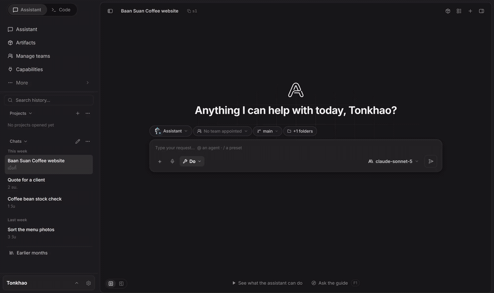

  

<h1 align="center">Aetox Harness</h1>

The Model Multiplier.

<h3 align="center">Hand it over. We'll run it.</h3>

  Say what you want. Aetox lines up the team and the tools, and hands back finished work.

<table>
<tr>
<td width="50%" valign="top">

**Assistant · Teams**

### Build a company on your computer

**You're the CEO. The rest is your team.** Set the goal and hand over the whole job. Heads split the work, teams
do it, and the finished files come back in one chat; you approve what goes out. The Content team ships with the
installer, so you start with a team, not an org chart.

</td>
<td width="50%" valign="top">

**Code**

### An ordinary model can do more than you think

The difference is the system around the model. For code, Aetox tunes its skills and every layer of the system to
work as one. Same model, and on some measures the results are clear: secure code **93.3%** vs 68.9% on GPT-6 Luna
and **97.8%** vs 77.8% on GPT-5.6 Terra, against the next-best harness (omp on Luna; OpenCode, omp and pi tie on Terra).

</td>
</tr>
</table>

Every number below compares the same model, with and without Aetox or against other harnesses:

| Area | Aetox | Compared with | Condition |
|:---|---:|:---|:---|
| Code · security | **93.3%** | 68.9%, the next harness: [omp 18.3.4](docs/reports/coding-harness-1.10.0/README.en.md#gpt-6-luna--reasoning-medium) | Secure code on CWEval · GPT-6 Luna · 3 rounds, hidden tests |
| Code · long runs | **95.2%** | 92.8%, the next harness: [OpenCode 1.18.32](docs/reports/coding-harness-1.10.0/README.en.md#gpt-56-terra--reasoning-medium) | Tests passed on SlopCodeBench · GPT-5.6 Terra · 3 rounds |
| Slides | **98** | 49, the same app with skills off | Thai deck, automatic checks · GPT-6 Luna · 3 runs |
| Thai tax invoice | **100** | 94, two other harnesses | [17 hidden tests, written by us](docs/reports/coding-harness-2026-09-27/tasks/F2-thai-invoice/hidden-tests) · GPT-6 Luna |
| Teams | **107k** | 190k, the same job without helpers | Main agent's context only, in one real session; not a controlled test |
| Video | **11.1 s** | 17.5 s, the raw take | Four silences folded, one filler cut, still editable |

  Where Aetox trails: it spends more tokens than other harnesses (about 90% cached), and on large models it is
  not the fastest. <a href="#measured-results">Method and where it loses</a>

  

  <strong><a href="https://github.com/Mikedev115/Aetox/releases/latest/download/aetox-amd64-installer.exe">Download the Windows installer (.exe)</a></strong>
  · <a href="https://github.com/Mikedev115/Aetox/releases/latest/download/aetox-cli-setup.exe">Aetox CLI</a>
  · <a href="#install">Scoop and portable zip</a> 
  Windows 10+ · x64 · Free to use · Bring your own model, or run one locally for free

  <a href="https://mikedev115.github.io/Aetox-landing/">Website</a> ·
  <a href="docs/release-notes/">What's new</a> ·
  <a href="docs/reports/README.md">Reports</a> ·
  <a href="README.th.md">ภาษาไทย</a>

  

*Scripted walkthrough of the real app, not a benchmark run.*

## Quick start

1. **Install** from the Microsoft Store or with the installer above. Pick one channel and stay with it: the Store
   build and the installer build keep separate settings, chats and keys.
2. **Connect a model.** Open **Settings › Models** and sign in with ChatGPT, GitHub Copilot or OpenRouter, or paste
   a key, or point it at LM Studio or Ollama on your machine.
3. **Give it a job.** Pick **Assistant** for files, documents and the web, or **Code** for a project folder, and
   say what you want done.

## Why the same model does better

The model thinks. The harness does the rest.

- **Hands.** Real files, a real browser, a real terminal. The model writes; Aetox hands back the `.xlsx`, the
  deck, the commit.
- **Knowledge the model doesn't have.** Skills carry what a model can't guess: the 1280×720 frame of a slide room,
  how an attacker breaks a path check, how a Thai tax invoice rounds.
- **Skills built into the system, not bolted on.** Each skill is written against Aetox's own tools, checks and file
  builders, so the model reads it and acts on it with hands that fit. Every new or tuned skill is measured on the
  same model with it on and off; skills that did not help were taken out.
- **A check before it hands work back.** It runs the tests, opens the file it made, and says what it could not
  prove.

The same harness drives all 31 providers, so the gain moves with you when you change models.

## Measured results

Coding: 11 tasks × 2 public OpenAI models ([`gpt-6-luna`](https://developers.openai.com/api/docs/models/gpt-6-luna), [`gpt-5.6-terra`](https://developers.openai.com/api/docs/models/gpt-5.6-terra), medium reasoning) × 3 rounds against four other
harnesses, every task judged by hidden tests, the same account and no user settings on any harness.

- **Secure code** — 93.3% against 68.9% for the next harness (omp) on Luna, 97.8% against 77.8% on Terra (OpenCode, omp and pi tie). The lead comes
  from the security skill that ships switched on: with it off, Aetox lands in the same range as the others.
- **Long multi-turn coding** — the most tests passed on both models (Terra 95.2%, Luna 91.6%).
- **Slides and Thai documents** — skills on against skills off on the same model: a Thai deck 98 against 49, a
  Thai tax invoice 100 against 85–94.
- **Where it trails** — more tokens than the others (Luna 6.4M against 0.8–4.5M, about 90% cached input), slower
  than two harnesses on Terra, and one SWE-bench bug on Luna fixed in 1 of 3 rounds.

Rounds swing by 1.5–2.5 points, so a gap of a few points reads as a tie. Every prompt, starting file and hidden
test is published so you can run it yourself: [the latest coding report](docs/reports/coding-harness-1.10.0/README.en.md) ·
[skills on and off](docs/reports/SKILL-BENCH.md) · [all reports](docs/reports/README.md).

## Inside the box

| | What it does | More |
|:---|:---|:---|
| **Code** | Agent mode works through your project; Editor mode lets you write while it helps. Language servers, Git, a real terminal | [Code](https://mikedev115.github.io/Aetox-landing/features/#code) |
| **Assistant** | Meetings, receipts, research and data become files that open: summaries, Excel, Word, PowerPoint | [Assistant](https://mikedev115.github.io/Aetox-landing/features/#assistant) |
| **Teams** | Hand a whole job to a ready-made team; see who did what, what each handed over and what it cost | [Teams](https://mikedev115.github.io/Aetox-landing/features/#teams) |
| **Studio** | A long video becomes short clips with subtitles you keep editing | [Studio](https://mikedev115.github.io/Aetox-landing/features/#studio) |
| **Phone** | Your PC's Aetox on Android or iPhone; keys never leave the PC | [Phone setup](https://mikedev115.github.io/Aetox-landing/download/#mobile-preview) |
| **CLI** | The Code desk in your terminal, sharing the app's keys, chats and memory | [Install](#install) |

## Models

31 providers, cloud and local. ChatGPT (Codex), GitHub Copilot and OpenRouter sign in; the rest take an API key or
a local server address. LM Studio and Ollama get the same tools as a frontier model. Switch model mid-chat and the
whole context comes along. Model lists are asked of the provider at run time, so a new model shows up without a
new Aetox. [Every provider](https://mikedev115.github.io/Aetox-landing/features/#models)

Pictures can stay on your machine too: point Aetox at ComfyUI or Stable Diffusion WebUI (Forge Neo, Forge or
A1111) and it draws on your own GPU, FLUX.2 klein included. [Local pictures](docs/LOCAL-IMAGES.md)

> **Free to use, not free cloud inference.** Real work needs a model: an account or key you already have, or a
> local model. Your provider's pricing applies.

## Install

| Channel | Install | Updates |
|:---|:---|:---|
| **Microsoft Store** | [Store page](https://apps.microsoft.com/detail/9N4KKBRRSCZZ) or `winget install --id=9N4KKBRRSCZZ --source=msstore` | Windows updates it |
| **Installer** | [aetox-amd64-installer.exe](https://github.com/Mikedev115/Aetox/releases/latest/download/aetox-amd64-installer.exe) | In the app: **Download the update → Restart to update** |
| **Aetox CLI** | [aetox-cli-setup.exe](https://github.com/Mikedev115/Aetox/releases/latest/download/aetox-cli-setup.exe) | Per user, no admin rights, adds itself to PATH |
| **Scoop** | `scoop install https://raw.githubusercontent.com/Mikedev115/Aetox/main/scoop/aetox.json` | `scoop update aetox` |

The installer is not code-signed yet, so Windows may show **"Windows protected your PC"**: choose **More info →
Run anyway**, or use the Store build, which Microsoft signs. Portable zip, antivirus notes and what to do when an
update does not take: [the update guide](docs/UPDATING.md).

## Safety and your data

- **Your data stays on your machine** — chats, files and browser data live on your disk; no server of ours in
  between and no analytics. A cloud provider sees what its API normally sees.
- **Keys** are locked to your Windows account and stripped from logs and tool results.
- **You choose how much it may do** — Ask · Unsafe only · Full access. Publishing anything outside and stopping
  programs by name are asked about at every level.
- **Secret files are refused** — `.ssh`, `.aws`, Windows credential stores, browser profiles and Aetox's own key
  files cannot be opened by any tool.
- **What enforces it** — these rules are checks inside Aetox's own code, not an operating-system sandbox. For a
  machine with data you cannot lose, give Aetox an API key of its own and run it in a VM or Windows Sandbox.

[Safety in detail](https://mikedev115.github.io/Aetox-landing/safety/)

## Source, licence and who makes it

Aetox is free to use and is not open source. Install it on as many machines as you like and use it for commercial
work; do not modify, redistribute, rebrand or sell it ([LICENSE](LICENSE)). Skills, agents, prompts and MCP servers
you write are yours, and selling them is permitted (§4). The source in this repository stops at v1.7.0 and stays
here to read and audit. Later releases ship as binaries only, so the version you run has no source to read; [what
you can check without it](#safety-and-your-data). Each release lists the SHA-256 of every file in
`checksums.txt`, signed with the app's update key, and releases built after 21 Oct 2026 also carry `sbom.txt`: every Go module
and web package built into it. The Go part can be checked against the binary itself with `go version -m aetox.exe`.
The Microsoft Store build is signed by Microsoft.

Aetox is written by one person. Questions and ideas: the [Facebook group](https://www.facebook.com/share/g/1BnXC5EiWg/).
Bugs: [issues](https://github.com/Mikedev115/Aetox/issues) — **Settings** in the app prefills one with your
version and a log with secrets already stripped. ❤️ [Support the project](SPONSOR.md)

---

  © 2026 Chayaphon Phromsawana · All rights reserved · <a href="LICENSE">Licence</a> · <a href="THIRD-PARTY-NOTICES.md">Third-party notices</a>

