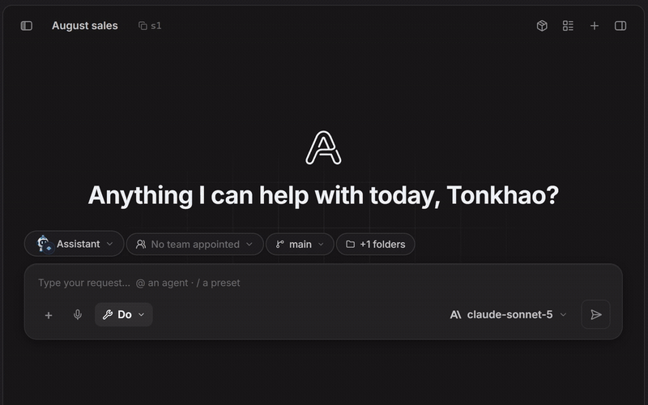
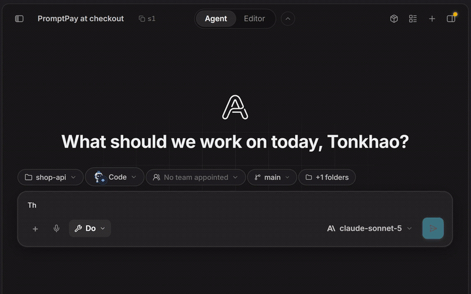
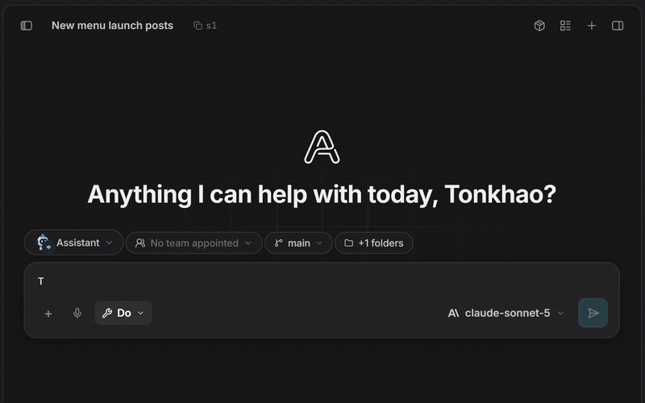
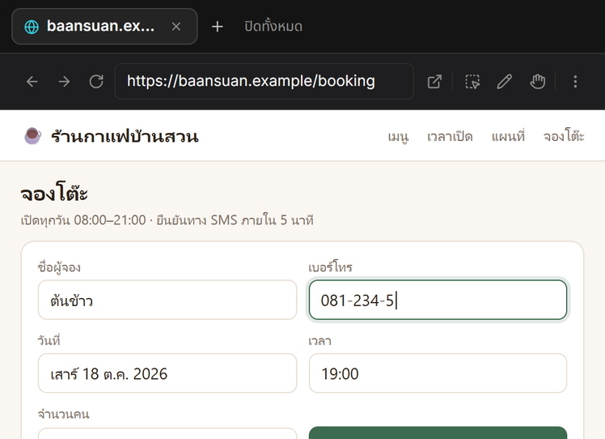
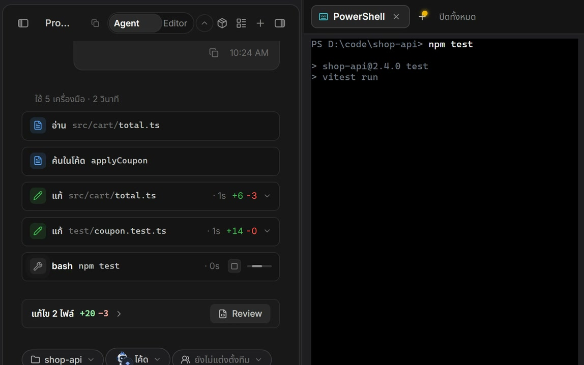

<p align="center">
  
</p>

<h1 align="center">Aetox Harness</h1>

<p align="center"><sub>The Model Multiplier.</sub></p>

<h3 align="center">The best harness for the AI you already use.</h3>

<p align="center">
  <strong>Don't change your model. Change the harness.</strong><br>
  The AI you already use becomes an assistant that gets real work done, and the strongest Code mode on the same model.
</p>

<p align="center">
  <strong>Assistant: real work, finished as files</strong><br>
  Record a meeting, get a summary with times and tasks · a folder of receipts becomes an Excel table ·
  a long video becomes short clips you can keep editing · data becomes a PowerPoint deck
</p>

<p align="center">
  <strong>Code: the strongest on the same model</strong><br>
  Secure code <strong>93.3%</strong> vs 68.9% · long multi-turn coding <strong>95.2%</strong> vs 92.8% ·
  our own security skill puts it 20+ points ahead of other harnesses ·
  <a href="#measured-results">results and where it loses</a><br>
  <sub>Measured with GPT-6 Luna (budget) and GPT-5.6 Terra (large) driving, the same model on every harness.
  Aetox isn't tied to either: it works with 31 providers.</sub>
</p>

<p align="center">
  <a href="https://apps.microsoft.com/detail/9N4KKBRRSCZZ"></a>
</p>

<p align="center">
  <strong><a href="https://github.com/Mikedev115/Aetox/releases/latest/download/aetox-amd64-installer.exe">Download Windows installer (.exe) from GitHub</a></strong><br>
  Direct download. No Microsoft Store required.
</p>

<p align="center">
  Windows 10+ · x64 · Free to use · Bring your own model, or run one locally for free
</p>

<p align="center">
  <a href="https://mikedev115.github.io/Aetox-landing/">Website</a> ·
  <a href="https://github.com/Mikedev115/Aetox/releases/latest">All downloads</a> ·
  <a href="https://github.com/Mikedev115/Aetox/releases/latest/download/aetox-cli-setup.exe">Aetox CLI</a> ·
  <a href="README.th.md">ภาษาไทย</a>
</p>

<p align="center">
  <a href="https://mikedev115.github.io/Aetox-landing/assets/hero-en.mp4"></a>
</p>

*Scripted product walkthrough using the app UI, not a timed live run or benchmark result.
[Watch the MP4](https://mikedev115.github.io/Aetox-landing/assets/hero-en.mp4).*

### Choose how to install

| Microsoft Store | GitHub installer |
|:---|:---|
| [Get it from Microsoft Store](https://apps.microsoft.com/detail/9N4KKBRRSCZZ). Microsoft signs the package; Windows handles updates. | [Download the Windows installer (.exe)](https://github.com/Mikedev115/Aetox/releases/latest/download/aetox-amd64-installer.exe). Install directly without the Store; use Aetox's in-app **Download the update → Restart to update** flow for new releases. |

The GitHub installer is a first-class option, not just a fallback. It may show a Windows SmartScreen warning
because it is not code-signed yet; see [installation and safety notes](#install).
**Choose one channel:** Store and installer builds keep separate settings, chats and keys.
[Scoop, portable ZIP and CLI](#install) · [Update guide](docs/UPDATING.md)

## Aetox Mobile — Android and iPhone

A phone chat for the Aetox on your PC: chats, models, files and the agent stay on **Windows**, the phone is the screen. Pick the model and thinking level, attach photos or files, answer approvals, and open delivered files. **Talk to it:** dictate into the box, or hold a voice conversation that is answered aloud sentence by sentence, using the speech engine and voice set in Aetox on Windows. Answers stream in as they are written, with each tool step shown; every chat on the PC is there, grouped by project; files the agent hands over open full screen (documents, images, video, pages and slides). It wears the same themes as the desktop app. Provider keys never leave the PC.

Both phones need Aetox for Windows **1.9.28 or later** (it includes **Aetox Link**) and Tailscale with HTTPS on the PC and the phone. Windows and Aetox must stay running. Start on the PC: **Settings › Mobile**, wait for the three Tailscale checks to turn green, press **Let my phone connect**, and a pairing QR appears.

### Android — app 0.3.2

[**Download the Android APK**](https://github.com/Mikedev115/Aetox-Harness/releases/download/mobile-v0.3.2/Aetox-Mobile-Android-Test.apk) · [Release notes and setup requirements](https://github.com/Mikedev115/Aetox-Harness/releases/tag/mobile-v0.3.2)

1. Install Tailscale on the phone and sign in to the same account as the PC.
2. Download the APK above and open it. Android asks once to allow installs from your browser.
3. Open Aetox Mobile and scan the QR on the PC, then press **Allow** on the PC.

The app tells you when the PC carries a newer version (**Settings › Connection › App version**) and updates in one tap. Android 10 or later.

### iPhone — web app, no App Store

There is no IPA. The iPhone runs the same screen as a full-screen web app with its own icon.

1. Install Tailscale from the App Store and sign in to the same account as the PC.
2. Point the Camera at the QR on the PC. Safari opens your PC's address; press **Allow** on the PC.
3. In the web app open **Settings › Install › Download iPhone Web Clip**, then iPhone **Settings › Profile Downloaded › Install**. The Aetox icon lands on the home screen.
   Or skip the profile: Safari **Share › Add to Home Screen**.

The profile only adds this one web app (no VPN, MDM or certificate) and can be removed in **Settings › General › VPN & Device Management**. It is made for your PC's address, so it is not published as a public installer. Updates arrive with Aetox for Windows; reload when the app says an update is ready.

## What will you get done?

| Your task | How Aetox helps |
|:---|:---|
| **Everyday work** | Read files, research the web, and create editable documents in **Assistant**. |
| **Software work** | Explore a project, edit code, and run checks in **Code**. |
| **Multi-part jobs** | Delegate to **agent teams** from either workspace. |

### See the workflows

Assistant and Code are the two workspaces. Teams are available from both, not a separate third workspace.
Open a walkthrough below; each is a scripted English product demo, not benchmark evidence.

<details>
<summary><strong>Assistant: everyday work, documents and research</strong></summary>

Read and work with files, websites and documents on the workbench beside your chat.

[](https://mikedev115.github.io/Aetox-landing/assets/mode-assist-en.mp4)

[Watch the MP4](https://mikedev115.github.io/Aetox-landing/assets/mode-assist-en.mp4) · [More about Assistant](#the-assistant-door)

</details>

<details>
<summary><strong>Code: read projects, edit files and run checks</strong></summary>

Work inside a project with its file tree, editor, Git, language servers and a real terminal.

[](https://mikedev115.github.io/Aetox-landing/assets/mode-code-en.mp4)

[Watch the MP4](https://mikedev115.github.io/Aetox-landing/assets/mode-code-en.mp4) · [More about Code](#the-code-door)

</details>

<details>
<summary><strong>Delegate to teams: split a multi-part job across specialists</strong></summary>

Hand a whole job to a team from Assistant or Code. Follow the head and specialists in one delegation tree.

[](https://mikedev115.github.io/Aetox-landing/assets/mode-team-en.mp4)

[Watch the MP4](https://mikedev115.github.io/Aetox-landing/assets/mode-team-en.mp4) · [More about teams](#teams-from-assistant-and-code)

</details>

### Your model. Your workspace. Your control.

- Connect a supported **cloud provider or local model**.
- Review permission requests and **watch the work** on your desk.
- Inspect the published **benchmark methods, results and limitations**.

[Safety & data](#safety-and-your-data) · [Measured results](#measured-results) ·
[Licence](#source-licence-and-who-makes-it) · [Community](https://www.facebook.com/share/g/1BnXC5EiWg/)

> **Free to use, not unlimited free cloud inference.** The built-in `aetox` provider shows the app and its guide,
> but real work needs a model: an account or key you already have, or a local model. Your chosen cloud provider's
> pricing applies when you connect your own account. Local-first does not mean
> cloud requests stay on your machine: cloud models receive the requests you send them.
> **Free to use, not open source:** Aetox is a one-person hobby project, and new releases ship as binaries to
> protect that work. The source up to v1.7.0 stays readable here. [Why, and what you can still do](#source-licence-and-who-makes-it).

**Jump to:** [Workspaces](#one-harness-two-workspaces) · [System over model](#system-over-model) ·
[Assistant](#the-assistant-door) · [Code](#the-code-door) · [Teams](#teams-from-assistant-and-code) · [Models](#which-models-it-works-with) ·
[Measured results](#measured-results) · [Install](#install) · [Safety](#safety-and-your-data) ·
[How the system works](#how-the-system-works) · [Licence](#source-licence-and-who-makes-it)

## One harness, two workspaces

**Aetox Harness is a Windows-native agent harness:** the system around a model that supplies tools, a workspace,
permissions, memory, and a verification loop so it can do real work rather than only generate an answer.

| If you want | Open the surface | Aetox gives you |
|:---|:---|:---|
| AI that works with your files, the web and documents on your machine | **Assistant**<br>Use, remember, and create | Real file reads and writes, real commands, and a real browser you watch and can take over. It reads images, PDFs and audio, and hands back spreadsheets, documents and slides that actually open |
| To write, fix and test code | **Code — flagship use case**<br>Build, debug, and ship | A desk bound to your project. Agent mode lets the agent do the work; Editor mode lets you write while Aetox helps. Language servers, Git, a real terminal, and `aetox` in your terminal too |
| To split work across several roles at once | **Assistant or Code → appointed teams** | Your main agent hands the whole job to a team, department or company; its head splits the work and returns real files. No separate secretary chat |

Assistant and Code share one harness, keys, memory, settings and permissions; switch in the top bar at any time.
Since [v1.9.21](docs/release-notes/v1.9.21.md), the separate Team door is closed: both main agents delegate to
teams directly, and the old team rooms and chat history sit behind Assistant. It works with [31 external model providers](#which-models-it-works-with), cloud and local; the
built-in `aetox` provider only shows the app and its guide until you connect one. The interface ships in Thai and English, with Thai
as the default. **[Install](#install)** from the Microsoft Store, the installer, or as Aetox CLI.

## System over model

**Models provide intelligence; Aetox provides the system that lets them act.**

```
                     MODEL        ← the brain: knows what should be done
                       ↓
                  ┌─────────┐
                  │  AETOX  │     ← the body: eyes, ears, hands, tools, permission
                  └────┬────┘
              ┌────────┴────────┐
              ↓                 ↓
          Assistant            Code
       files web docs       project Git
              └────────┬────────┘
                       ↓  delegate whole jobs
             Team / Department / Company
                   head → agents
```

> **The north star of this project.** *Do not build an AI that answers more. Build an AI that does more.*

There is a word for this arrangement: a **harness**, the program around a model that gives it tools, a loop,
and somewhere to work. The model is the engine; the harness is the car. That is why the same model can be a
different product in two apps, and why a published score belongs to a model and a harness together, never to
the model alone.

Much of what people assume has to come from a bigger model is, in Aetox, the system's job:

1. **A blind model drives the browser** — the system numbers every element on the page, so a model with no
   vision clicks the right button without guessing coordinates → [Assistant door](#the-assistant-door)
2. **A blind model reads images, a model that cannot hear transcribes, a model that only writes text hands back
   real files** — Thai and English OCR, offline speech-to-text, and the builders for `.xlsx` `.docx` `.pptx`,
   decks and video belong to the app → [Assistant door](#the-assistant-door)
3. **A small local model does big work** — a 9B/35B model in LM Studio or Ollama gets the same tools as a
   frontier one, and your prompts never go to a model provider → [Which models it works with](#which-models-it-works-with)
4. **Same model, different result** — on GPT-6 Luna (`gpt-6-luna`, through the same ChatGPT (Codex) account for
   every harness), code passing the security tests (CWEval func-sec@1): Aetox 93.3% · OpenCode 66.7% ·
   Codex CLI 66.7% · omp 68.9% · pi 64.4%, judged by hidden tests (11 tasks × 2 models × 3 rounds). The lead comes from the
   bundled security skill: with it off, Aetox lands in the same range as the others. The method and where Aetox
   loses are in [Measured results](#measured-results)
5. **Many tools do not mean a full context** — an MCP server with 212 tools costs a 135-token index, and the
   definitions load when they are actually used → [How the system works](#how-the-system-works)
6. **An organisation run by the system, not by pleading in a prompt** — your words reach the head at every
   level verbatim, send-back rounds are counted by the system, and heads hold no run slot, so work fans out
   across several levels at once without deadlocking → [Teams](#teams-from-assistant-and-code)

The app is two self-contained executables — `aetox.exe`, the window, and `aetox-engine.exe`, the engine that
thinks and works. No runtime to install, no `node_modules`, no bundled copy of Chromium. Because the engine is
a process of its own, it can run on another Linux machine: add the host under ตั้งค่า › เครื่องระยะไกล and
connect, and the app ships the engine over your own `ssh`; the chat, files, terminal and Git you see are that
machine's. Your provider keys never leave the machine the window runs on — the engine asks the window to sign
each request.

## The Assistant door

*Use, remember, and create* — the assistant works across the whole machine when no project is focused, or
inside a project folder plus the folders you add. Everything happens on the workbench beside the chat. Its start
page leads with **Waiting for you** (meetings not yet turned into notes, drafts to keep), then **Work** and
**Calendar**, then the rooms where work is made (**Slides**, **Cutting room**, **Artifacts**) and where it is
opened or handed on (**Browser**, **Files**, **Workroom**). The agent does not work behind a curtain and hand you a
file at the end; it opens a room, works in it, and you can reach in and change something yourself without
waiting for the turn to finish. The assistant has files and a shell, so it does software work too, and it
never hands a request back because it involves code.

> **What the system does for the model at this door**
> - Numbers every element on a web page, so a model with no vision clicks the right button
> - Turns images into text with Thai and English OCR, and transcribes audio offline on your machine
> - Builds `.xlsx` files with working formulas, `.docx`, `.pptx`, slide decks and video
> - Does arithmetic in a JavaScript interpreter compiled into the app, and shows you the script to check
> - Searches past conversations with SQLite on your machine, spending no tokens
> - Asks you before anything is posted, sent or shared outside, at every permission level

**A real browser you can watch.** Not a headless scrape: a WebView2 window composited into the app, with an
address bar, back and forward, DevTools, and eight device presets that resize the native window so CSS media
queries genuinely fire. The layer that drives it is ours, designed and built for Aetox; click and type aim at an
element's number, not at x,y coordinates. Every tab has a **Let the agent use this tab** button: lit means the agent
may touch that tab, and switching it off makes the tab yours.



**Images, PDFs and audio.** `image_ocr` runs Tesseract in Thai and English, so a screenshot, a scan or a
photographed form becomes text a 9B/35B model can reason about; a model that *can* see gets the image itself.
PDFs are read with the layout intact and audio is transcribed offline. Hand over a folder and ask for what you
actually want — *"go through this folder of receipts and give me one spreadsheet"*: it OCRs each image, works
out the totals in the JavaScript interpreter, puts the script beside the answer, and writes a real `.xlsx`
with live formulas.

**Real files back.** A deck comes back as one self-contained `.html` file, editable by hand and openable on any
machine with a browser. Page through it, present it full screen, and export `.pdf`, `.png` or `.jpg` from the
slides room; the PDF comes from the same renderer that drew it on screen, and the 1280x720 slide is exactly
PowerPoint's widescreen page. `.xlsx`, `.docx` and `.pptx` are the `sheet` and `doc` agents' work, video is
`video`'s, and voice-over comes from `voice_make`.

**Hand work to a specialist.** Pick someone off the `+` menu — `@doc`, `@sheet`, `@deepresearch`, `@video` —
and your sentence reaches that agent word for word, not a paraphrase. (Typing `@` yourself does nothing, on
purpose: a pasted draft that merely quoted an agent's name once sent a whole brief to the wrong worker.) Or let
the assistant delegate through `task`: up to four specialists run at once, so three jobs cost the time of the
slowest rather than the sum. One that reaches a decision it should not make alone comes back as a question
under its name in the chat, and one still working when your answer arrives keeps going — the end of a turn is
not a deadline.

<details>
<summary>A real run: find 20 CRMs and compare them in a spreadsheet</summary>

Run on 2026-08-15, from one sentence — *"find 20 CRMs a Thai SME could actually pick and give me a spreadsheet
comparing them"*: **6m 51s, two agents, 42 tool calls between them** — 8 by the assistant, 27 by
`deepresearch` reading pricing pages, 7 by `sheet` — and one tool failure it worked around. `deepresearch` left
a report in the session's output folder and `sheet` was given the *path*, not the contents.

Twenty rows came back, fourteen with a real numeric price sorted low to high, and **six deliberately left blank**
with the reason beside them — quoted-only pricing, or a page that would not state a figure. Every row carries
the date the page was read and the link the number came from. The blanks are the part worth trusting: a table
with no gaps in it is a table that guessed.

</details>

**Give it a job, not a step.** Long work is planned before it is worked, and the plan sits on screen as one box
ticked off as it goes, so what you watch is the order it chose rather than a spinner. For thinking before acting
there is a planning mode that can read anything and change nothing; that button is yours alone, and the model
cannot switch itself into it. Two chats can sit side by side in one window (`Ctrl+\`).

**Chats can write to each other.** Copy a chat's ID beside its title or from its menu, then ask another chat to
send it a question or an update. The receiving chat handles the message while working or opens a turn for it
when idle; a question accepts one reply. A closed chat in another project must be opened first.

**It remembers, and you can undo.** The assistant writes down what is worth keeping on its own — when you
correct it, confirm an unusual approach, or make a decision the code does not show — and the card under the
answer shows the kept line with an **Undo** button. A fact you declined or undid is never kept again, in any
wording. Lessons from a mistake repeated three times still wait in the review queue for you to accept or
discard. Everything kept is plain markdown you can open, edit or forget. **Standing instructions** are your
own always-on files that ride into every desk, every project and every agent. Every conversation and tool run
lives in local SQLite with FTS5, so `session_search` is a query on your machine rather than a question to the
model, in Thai and English alike.

**Connect the services you already use.** Paste a link, an install command, or just the name of an MCP server
or skill into the chat; the system finds the official one, checks whether it needs a key or OAuth, and puts up
a card for you to press. Every install needs a person to press it. The MCP library in the app shows each
server's measured tool count and tokens before you install. Built-in account connections are n8n and Windmill
(the `automation` agent builds and edits workflows — read the limits in
[How the system works](#how-the-system-works) before you rely on it), Meta (the `ads` agent reads ad accounts,
`content` posts to Pages) and YouTube (the `youtube` agent uploads clips).

**A companion that lives on your desktop.** The robot mascot is drawn from code, has poses for what the
assistant is doing, greets you by name and reads its finished answer aloud. Keep it in the window, or let it
out onto the desktop as a real Win32 window you can drag to any monitor.

<details>
<summary>Use the assistant from Telegram or Discord</summary>

Open **Yours → Connections**, then choose Telegram or Discord:

1. Telegram: create a bot with `@BotFather` and connect its bot token.
2. Discord: create an app in the Discord Developer Portal, add a bot, and invite it with View
   Channels, Send Messages, and Read Message History. Message Content Intent is not required.
3. Aetox shows a one-time `/pair 123456` command after connecting. Send it from the Telegram chat
   or Discord channel you want to authorize (mention the bot when pairing in a Discord server).

This is Aetox's real main assistant, not a separate bot: it uses the Assistant desk's identity and tools. Each
paired chat or channel keeps its own conversation history. The bot accepts messages only from the paired
conversation; mention it in Discord server channels, while DMs work directly. Use `/new` to start with fresh
context. Tokens and pairing data are encrypted at rest, and listeners run only while Aetox is running.

</details>

## The Code door

*Build, debug, and ship* — the second door is a workshop, not a chat with a coding mode switched on. It is
bound to the project folder you open and has working rules of its own: a turn ends when the work is done, not
when a plan for it is written; done means proven by execution; new work has a test in the project's own suite;
and after the narrow test comes the project's full check.

> **What the system does for the model at this door**
> - Asks the language server where an identifier is declared, who calls it, and what a change would affect
> - Loads an `.html` page it just wrote at desktop and phone width, light and dark, and reports what to fix
> - Hands the model the result of a command that has been still for 2 minutes, instead of waiting out the timeout
> - Sends back an answer that says itself the work is unfinished, to be finished
> - Keeps history already sent unchanged, so the provider's cache holds every round
> - Snapshots files before every turn edits them with shadow-git, so any turn can be undone

### The security skill: code that holds up to attacks

Our own security skill makes AI write code that holds up to attacks, 20+ points ahead of other harnesses. Tested
with the same GPT models on every harness: 93.3% vs 68.9%, and 97.8% vs 77.8% (CWEval func-sec@1). It ships
switched on.

Switch on this one skill and the same model writes 14.0 of 15 functions that both work and hold up, instead of
10.2. On the same build, with only the skill switched (CWEval, 5 rounds per setting):

| Functions that work and hold up, of 15 | Skill off | Skill on | Other harnesses |
|---|---|---|---|
| Budget GPT model (GPT-6 Luna) | 10.2 | **14.0** | 9.7–10.3 |
| Large GPT model (GPT-5.6 Terra) | 11.6 | **14.4** | 11.0–11.7 |

Holes that closed, runs out of 10 that worked but leaked: SSRF 4 → 0 · new lines in an HTTP header 7 → 0 ·
new lines in a log 5 → 0 · a user's regex with unbounded cost 10 → 1. The code works just as well with the skill
on. With it off, Aetox lands with the other harnesses: the lead is the knowledge in this skill.
[The test](docs/reports/coding-harness-1.9.27/README.md#2-ชนะ-cweval-เพราะอะไร)

### Two modes: Agent · Editor

The switch in the top bar changes mode at once. Each mode is a desk of its own with its own chat list, bound to
the same project.

The mode switch can be folded into a small tab that still names the mode and shows whether the chat is working
or waiting on you. Git now has fetch, pull and push, ahead/behind counts, a branch graph, and a menu for opening
or creating worktrees. A pull starts with fast-forward; a diverged branch offers rebase or merge.

**Agent — the agent works, you watch the workbench.** The chat sits on the left and the workbench on the right:
a real ConPTY terminal with unlimited tabs, the browser the agent drives, the file tree, Git with the commit
timeline on the same page, and a code map.



- **Find out why a test is flaky** — it greps the repo, runs the suite in a terminal tab you are watching,
  reads the failure, and edits the file.
- **Know what a name is before you trust it** — `codebase` asks the language server instead of a text search
  that has to guess.
- **See the shape of a repository you did not write** — a code map of the whole tree, with `grep` and `glob`
  across all of it.
- **Write a page and know at once where it breaks** — the check comes back with the write: a broken script,
  text under AA contrast, a page wider than the phone, a dark mode still light underneath, Thai marks that float
  or collide, and controls too small to tap.
- **Read a diff without leaving the conversation** — expand a tool row and the change shows as git hunks.

**Editor — you write, Aetox helps.** The file sits in the centre in Monaco, the right panel holds the agent,
Explorer, Git and deliverables, and terminals dock below. There is no extension market, so everything is built in.

- **Ctrl+K to edit in place** — a few words under the selected lines; the answer comes back as hunks you keep or
  revert one at a time.
- **Completions from any model** — DeepSeek, OpenAI-style and Ollama FIM endpoints, or any chat model, set
  separately from the chat's model.
- **Language servers behind the editor** — completion, hover, go-to-definition, a problems list and symbol
  search. The languages page is a catalogue of 44 servers, installed through a toolchain or downloaded from the
  server's own release with its SHA-256 checked.
- **Git in the editor** — changed lines in the gutter, blame on the cursor line, a side-by-side diff against
  HEAD, and committing hunk by hunk without touching the real index a shell may be using.
- Split view · run the test under the cursor · replace across the project · `.editorconfig` · format on save ·
  SQLite files open as read-only tables

### Long runs that actually finish

Real coding work runs for tens of minutes, and what brings it down is mostly not the model but what surrounds it.

<details>
<summary>How the system keeps long runs from hanging or failing, and why GitHub work lives with the github agent</summary>

- **A still command does not stall the turn** — "still" means no output, no CPU and no change in the process
  set, so a quiet compile that is still working is not counted as hung. Shell output is capped at 30 KB,
  keeping both the head and the tail, so one huge log does not make every later request dearer.
- **Dropped connections and 5xx really retry** — a failed DNS lookup or a cut connection retries at the
  connection layer and again at the turn layer; a 5xx backs off and retries at 2, 5 and 10 seconds instead of
  ending the turn in a fraction of a second.
- **Long sessions cost less** — tool results are plain text, re-reading lines still in the conversation says
  where they are instead of sending them again, and grep cuts between results, never through one.

GitHub work — searching repositories, reading and opening pull requests, reading CI, commenting — goes to the
`github` agent, which holds those tools. The Code desk stopped carrying GitHub and connected-service tools on
every request: in 30 days they were never called, yet they cost about 1.4k tokens every round. Merge and close
are deliberately absent: closing an argument is one click on a page you already have open. This desk also
deliberately has no document or spreadsheet writer, no OCR and no PDF or audio reader; a deck *about* code is
the Assistant door's job.

</details>

### Aetox CLI — the Code desk in your terminal

Type `aetox` in any folder to open the Code desk full screen: tools run above the prompt, permission cards are
answered in place, and you can type while it works.

```text
aetox                       full screen (--plain for line by line)
aetox chat "goal"           one turn, the answer on stdout, for scripts
aetox login codex           sign in to a provider (codex, copilot, ...)
aetox --whole-machine       tools reach the whole machine, credential stores stay closed — for disposable containers or VMs
aetox --report runs.jsonl   append one JSON line per turn: rounds, tokens, cost, seconds, tools
```

The CLI has [its own installer](#install), separate from the app. When the app is installed, the CLI uses the
app's engine, keys, chats and memory; without it, the CLI uses its own engine. It tells you when a new release
is out. This CLI is the build the coding benchmark measures.

### Coding results

On the same models against OpenCode · Codex CLI · omp · pi (11 tasks × 2 models × 3 rounds), Aetox leads on secure code on both
models (the lead comes from its bundled security skill) and has the highest share of tests passed in long
multi-turn coding on both GPT-6 Luna and GPT-5.6 Terra; on hard tasks with GPT-6 Sol it ties Codex CLI (1.9.7). It
trails on the single SWE-bench bug on Luna and on time with Terra, and the price is more tokens — see
[Measured results](#measured-results).

## Teams from Assistant and Code

*Arrange, start, and watch* — teams are a capability of both main agents, not a third door. Ask Assistant or
Code for the result you want; it can do focused work itself, use its own helpers, or hand a whole job to an
appointed team, department or company. The head splits that job, checks the members' work and returns it to
the main chat. There is no separate secretary to talk to.

**Set up once, delegate from the chat.** Manage the organisation under **Settings → Teams** and appoint who
each main agent may delegate to under **Settings → Main assistants → Assistant or Code → Delegation**
(ตั้งค่า → ตัวหลัก → ผู้ช่วยหรือโค้ด → มอบงาน). Making a team and appointing it are separate decisions;
the same team can serve both main agents.

Since [v1.9.23](docs/release-notes/v1.9.23.md), you can also ask Assistant to set up the team: it offers a draft
card, you press **Create**, and the app creates the organisation with an undo action. Teams made through this
card are appointed to Assistant; appoint them to Code separately if you want Code to use them too.

> **What the system does for delegated work**
> - Delivers your words to the head at every level verbatim, never rephrased
> - Gives heads no run slot, so a department hands work to three teams and a company to three departments at once
> - Counts how many times a head sends work back, instead of asking for a limit in the prompt
> - Carries company and department rules and context to the heads along the route the work took; members get only what they need
> - Lets every agent use its own model, so the cost follows each agent's work
> - Checks the organisation's shape: departments with no head, teams never used, agents holding the same tool set

### Three levels, each with a head that thinks

| Level | Made of | What the head does |
|:---|:---|:---|
| **Team** | a team head + agents | Takes the whole job, splits it into plain sentences, one non-overlapping deliverable per member, and judges what comes back |
| **Department** | a department head + teams | Broad work within one domain, handed to several teams at once; a team may belong to several departments |
| **Company** | a company head + departments | The whole picture, handed to departments or straight to a team; founded once three departments have heads |

The main agent picks **the lowest level that can own the job**: clear work for one team goes straight to that
team, broader work goes up to a department or the company. No level is a forced pass-through, because going
higher than the job needs costs a round and gains nothing. Members receive only their head's order and their
own seat in the team, and the team's rules reach everyone in it.

### Watch the work at every level

- **Stay in the main chat** — Assistant or Code sends the job to an appointed team, department or company.
  The old Team door's rooms and chat history are accessible from Assistant; there is no third door to switch to.
- **Delegated work is one tree in the chat** — the head on top, members below, each row saying what it is doing
  with a stop button of its own. A question appears under whoever asked it and is answered right there; click a
  row to open the full work in the right panel.
- **Deliverables are real files** — in the team's folder or the focused project, and they show up as cards in
  the main agent's answer.
- **The company room** — a 3D office opened from the company card in the Workroom (or Mission Control), with a campus or tower map (a 2.5D room on machines
  without WebGL). Each agent sits at a desk and moves with the tool it is using, heads have their own desks and
  ranks, finished work is carried off to delivery, time of day follows your clock, and a board shows done today
  · working · waiting on you.
- **The workroom** — save a pipeline where each step names the team that takes which piece; start it and it
  walks step by step, and a step that stops to ask resumes once you answer.
- **A web console** — the `:8317` page on your machine configures teams, departments and companies, and has a
  simulated phone that sends orders to the assistant. This is not a separate Secretary door.

### The organisation is plain files

Every level is markdown on disk. **Settings → Teams** (ตั้งค่า → ทีม) manages teams, departments and companies;
the organisation view draws the hierarchy, checks its shape and summarises what each team has spent.

```text
<DataRoot>/teams/<name>/TEAM.md                head · members · each member's seat · ## team rules
<DataRoot>/departments/<name>/DEPARTMENT.md    department head · teams · ## department context · ## department rules
<DataRoot>/companies/<name>/COMPANY.md         company head · departments · ## company context · ## company rules
```

The app seeds **ทีมคอนเทนต์** (the content team) as a led team, alongside the specialist roster
**ผู้ช่วยในคอมพิวเตอร์** (research, documents, spreadsheets and video). Keep, rename or replace those starting
files in Settings, or ask Assistant to draft a led team for your own work. Available workers and heads are
shown in the personnel directory; a led team reaches a main agent only when appointed to it.

### One agent is one folder

Hiring someone new is dropping a folder into `<DataRoot>/agents/` — no release, no plugin API, no restart. The
folder is the agent's whole identity: `AGENT.md` (who it is, which tools it narrows itself to, which model it
pins, and `role: head` for a head), `MEMORY.md` (what it has learned), `STARTERS.md` (how an empty chat with it
opens) and a private `skills/` folder no other agent can see.

That folder is where a clever assistant and an organisation part ways. Each agent pins **its own model, at its
own provider**, so the one that opens twenty pricing pages can run on something cheap while the one that weighs
what was found runs on something strong, and the bill follows the work instead of the hardest task in it. Each
keeps **its own memory**, so what the research agent learned about a source does not leak into the document
agent's judgement about a contract.

You can also talk to a worker directly in the specialist room or pick them from the chat's `@` menu.
Appointments are managed per main agent under **Settings → Main assistants → Delegation**; Assistant and Code each
have their own appointed organisation and helpers. Separately there are two **sub-agents** (`explore`, `general`):
internal helpers, a fixed set that cannot be extended by design, though you may tune each one's model,
provider, prompt, step ceiling and look.

## Which models it works with

**31 external providers, and the window shows every one** — OpenAI · OpenAI-compatible (your own endpoint) ·
Anthropic · Gemini · DeepSeek · Qwen · Z.ai · Z.ai Coding Plan · OpenRouter · Codex · Groq · Mistral · Kimi ·
MiniMax · MiniMax M-Plan · Chutes ·
Xiaomi MiMo · Xiaomi MiMo Token Plan · xAI · Meta · ThaiLLM · ModelScope · NVIDIA · GitHub Copilot · Kilo ·
Ollama Cloud · OpenCode Zen · OpenCode Go · LM Studio · Ollama · 9Router (Xiaomi MiMo and its Token Plan count
separately because they use different endpoints and keys, as do the MiniMax and Z.ai plans). The built-in `aetox`
provider is not counted among the 31: it shows the app and its guide, and does no work until a real model is connected. ChatGPT (Codex), GitHub Copilot and OpenRouter sign in; the rest take an API key or
a local server address. An endpoint you add yourself chooses its API shape (openai · anthropic · responses).

Local models are first-class: Aetox asks LM Studio and Ollama which model is *loaded*, streams both the answer
and the reasoning, makes real tool calls, and counts tokens into the same statistics. You can switch provider or
model mid-conversation and the whole context comes along — tool calls, results and compacted summaries, not just
the visible messages. Aetox never quietly reroutes your turn to another provider you happen to pay for. Model
lists, API versions and reasoning levels are asked of the provider at run time rather than written into the
code, so a new model shows up without waiting for a new Aetox.

Settings has an independent on/off switch per model: turning one off hides it from pickers without changing a
chat already using it. Stars are favourites. Search covers the full list while only a window of rows is drawn.
Under **Personnel**, employees and helpers share a searchable directory with rank and source filters;
their overview shows separate model choices. Each chat keeps its own selected model and reasoning dial.
9Router, LM Studio and Ollama have setup cards showing installation, server and model/key status.

## Measured results

The rules are in [BENCHMARK.md](docs/reports/BENCHMARK.md), and the one rule it enforces is that a number that
has not passed them does not appear here or on the website.

**Coding, 1.10.0.** Same models and byte-identical tasks as OpenCode · Codex CLI · omp · pi:
11 tasks × 2 models (`gpt-6-luna`, `gpt-5.6-terra`, medium reasoning) × 3 rounds, every task judged by hidden
tests, no user skills or settings anywhere, the same account for every harness.

- **Answers in the task's language** — on the English tasks Luna answered in English 13 times in 63 on 1.9.27 and
  63 in 63 on 1.10.0; Terra 47 → 63. Tasks written in Thai are still answered in Thai, 9 in 9. The engine now names
  the reply language on each message instead of asking the model to work it out
- **Secure code** — Aetox leads on both models: CWEval func-sec@1 93.3% against 68.9% for the next harness on
  Luna, 97.8% against 77.8% on Terra. Switching parts off on 1.9.27 (5 rounds each) shows where it comes from: with
  only the security skill off, Aetox secured 10.2 of 15 functions on Luna and 11.6 on Terra, the same range as the
  other harnesses; with every skill off, 10.6 and 11.2. The lead is the knowledge in that skill, which ships
  switched on
- **Long multi-turn coding** — the highest % tests passed and checkpoints fully passed on both models (Terra 95.2%
  and 7.0 of 14, Luna 91.6% and 4.0; OpenCode 92.8% and 6.7, 90.8% and 3.7)
- **Against 1.9.27** — Terra is better in nearly every column and faster (SlopCodeBench 93.8 → 95.2%, Web-Bench
  4.7 → 5.3 of 6, func-sec@1 93.3 → 97.8%, 70 → 63 min); Luna is faster again (31 → 26 min) and fixed the reported
  bug in all 3 rounds (1 of 3 before), while its SlopCodeBench moved 92.4 → 91.6%, within the swing between rounds
- **Hard tasks on GPT-6 Sol** (1.9.7) — DeepSWE 1.1 and Terminal-Bench 2.1 hard, 12 tasks at high reasoning:
  Aetox 7 · Codex CLI 7 · OpenCode 6
- **The price** — more tokens than the others (Luna 6.4M against 0.8–4.5M, Terra 8.3M against 1.8–7.5M; about 90%
  is cached input). Against 1.9.27 the full-price part fell (uncached input −6% on Luna, −5% on Terra) and cost per
  round fell 2% and 5%. Time: Luna 26 min, the fastest in the table; Terra 63 min against 46–71. The benchmark is
  one-shot, so the main agent does nearly all of it; in a real session helpers
  kept the main context at 107k instead of 190k and cut cost by about 6% on OpenAI prices, 18–30% on other providers
  ([session report](docs/reports/LIVING-REALM-DELEGATION-TOKENS-20261004.md) ·
  [cost report](docs/reports/MODEL-COST-SIMULATION-LIVING-REALM-20261004.md))
- **Where it trails** — the single SWE-bench bug on Luna by the dataset's own tests (1 of 3 rounds; the other two
  fixed `client_ip` as the report asks but not `remote_ip`) · time on Terra, behind pi (46 min) and Codex CLI (54)

Rounds swing by 1.5–2.5 points on SlopCodeBench, so a gap of a few points reads as a tie. The tables, every
round, the method and where Aetox loses are in the reports — start at [the reports page](docs/reports/README.md).

| Other reports | What they measure |
|:---|:---|
| [Reports page](docs/reports/README.md) | Every report, and the latest edition of each subject |
| [coding-harness-1.10.0](docs/reports/coding-harness-1.10.0/README.md) | The 1.10.0 edition against the same four harnesses, with what changed since 1.9.27 and the language of the answers |
| [coding-harness-1.9.27](docs/reports/coding-harness-1.9.27/README.md) | The 1.9.27 edition, with what makes Aetox lead on CWEval and a GPT-6 Sol run |
| [coding-harness-1.9.7](docs/reports/coding-harness-1.9.7/README.md) | The 1.9.7 edition, with two sets of rounds and the swing between them |
| [HARD-SOL-1.9.7](docs/reports/HARD-SOL-1.9.7-20261004.md) | Hard tasks on GPT-6 Sol: DeepSWE 1.1 and Terminal-Bench 2.1 hard, Aetox against Codex CLI and OpenCode |
| [HARD5-1.9.7](docs/reports/HARD5-1.9.7-20261004.md) | Five mid-level tasks across releases 1.9.0 → 1.9.7 and three model sizes |
| [MODEL-COST-SIMULATION](docs/reports/MODEL-COST-SIMULATION-LIVING-REALM-20261004.md) | One real session re-priced on eight other models, and what helpers save |
| [coding-harness-2026-09-27](docs/reports/coding-harness-2026-09-27) | The 1.9.0 edition against OpenCode · Codex CLI on the same tasks, with each task's prompt, source and licence |
| [SKILL-BENCH.md](docs/reports/SKILL-BENCH.md) | How much Aetox's skills actually help, skills on against off on the same model, including what did not move |
| [TOKEN-AUDIT.md](docs/reports/TOKEN-AUDIT.md) | Where the tokens go in each request |
| [TEST-REPORT.md](docs/reports/TEST-REPORT.md) | Tests by module |
| [aetox-research-reasoning-evaluation.md](docs/reports/aetox-research-reasoning-evaluation.md) | Research and reasoning evaluation |
| [PUBLISHED-NUMBERS.md](docs/reports/PUBLISHED-NUMBERS.md) | Where every published number appears, and where it was measured |

<details>
<summary>The app's own numbers — 1.9.27 package sizes and dated runtime figures</summary>

**1.9.27 packages, measured 17 October 2026.** Built locally; `relcheck` verified the release signature with the app's key and checked every uploaded artifact's digest. The app size was read from the published portable archive; the Store figure is the local package, not a completed Store submission. MiB is bytes / 1,048,576. Sizes are rounded separately; the total is calculated from bytes before rounding.
See the [package measurement history](docs/reports/BENCHMARK.md#13-ประวัติการวัด).

| Package | Size |
|:---|---:|
| App on disk, two executables | **114.6 MiB** (window 68.1 + engine 46.5) |
| App installer | **46.0 MiB** |
| Portable app | 45.2 MiB |
| CLI installer / portable | 29.5 / 40.0 MiB |
| Microsoft Store package | 46.6 MiB · version 1.9.27.0 · not submitted |

**Historical measurements below.**

The two size rows and the two test-count rows were measured on 2026-09-17 on v1.7.2; turn assembly on
2026-08-13; the rows marked ⁽ᵈ⁾ on 2026-07-27 on v0.9.2, before the engine became a process of its own, so
the process count is one lower than today. Every row is a dated figure, not a current one.

| | |
|:---|---:|
| What you download | Installer, 34.6 MB |
| What lands on disk | **83.4 MB** in two files — `aetox.exe` 50.9 MB + `aetox-engine.exe` 32.5 MB |
| Assembling one turn | 0.32 ms · 174.9 KB allocated |
| Go tests | 3,648 across 62 packages, none failing |
| UI tests | 2,106 across 205 files, none failing |
| First start (cold) | 1.77 s ⁽ᵈ⁾ |
| Later starts | 0.53 s ⁽ᵈ⁾ |
| RAM committed | 252 MB ⁽ᵈ⁾ |
| Processes | 7 ⁽ᵈ⁾ |

The old figures stay rather than being deleted, because on the day they were taken they passed the rules —
which is the whole difference between an old number and an unusable one.

Two things said plainly. Turn assembly was 0.12 ms and 96.2 KB when the block held 27 tools; it is 0.32 ms and
174.9 KB now, because the block holds more. That is a real regression, and it is still three ten-thousandths of
a second — the time you wait is the model thinking. And the size went from 48.5 MB in one file to 83.4 MB in two:
the engine is its own file now, but the window still links the engine packages for types and forwarders, so the
split added a binary without the first one shrinking. That is the real cost of splitting the engine out.

**Against Zed**, the harsher yardstick — native Rust, and known for being light.

| | Aetox | Zed |
|:---|:---|:---|
| First start (cold) | 1.77 s | 2.12 s |
| Later starts | 0.53 s | 0.53 s |
| RAM committed | 252 MB | 471 MB |
| Size on disk | **83.4 MB** | 419 MB |

Every cell except Aetox's size was measured on 2026-07-27 on the same machine under the same rules, and neither
has been re-measured. Electron apps in this category ship 240 MB to 1 GB because each carries its own Chromium.
Aetox uses the WebView2 Windows already has — and WebView2 *is* Chromium, so memory is not where it beats
Electron; the win is that you do not keep a second browser.

**How it was measured.** Size on disk: unpack the
[portable zip](https://github.com/Mikedev115/Aetox/releases/latest/download/aetox-windows-amd64-portable.zip) and
add the two files; other apps are measured from their install folder after installing, never from a download
page · start-up, RAM and processes: `bench.ps1 -Start`, an empty project, median of 5 runs after discarding the
first, read after 60 seconds idle; a true cold start needs a reboot first · turn assembly: `bench.ps1 -Engine`,
median of 3 runs.

**What was removed.** An earlier README published "97% of input tokens came from cache across six consecutive
messages" and local time-to-first-token figures of 1.42 s and 1.75 s. Neither had a source in this repository —
no test, no log, no BENCHMARK entry — so they were removed rather than dated.

</details>

## Install

Windows 10 or later, x64. **You do not need an API key to start**: the built-in `aetox` provider ships trial
models that exercise the real machinery — real tool calls, real delegation, long streamed reasoning — so you see
what the app does before signing up for anything.

| Channel | Install | Best for |
|:---|:---|:---|
| **Microsoft Store** | `winget install --id=9N4KKBRRSCZZ --source=msstore`<br>or the [Store page](https://apps.microsoft.com/detail/9N4KKBRRSCZZ) | Signed by Microsoft: no SmartScreen prompt, and Windows keeps it updated |
| **Installer** | [aetox-amd64-installer.exe](https://github.com/Mikedev115/Aetox/releases/latest/download/aetox-amd64-installer.exe) | Program Files with a Start-menu shortcut |
| **Aetox CLI** | [aetox-cli-setup.exe](https://github.com/Mikedev115/Aetox/releases/latest/download/aetox-cli-setup.exe) | The Code desk in your terminal; installs per user, no admin rights, adds itself to PATH, not in the Store |

Other ways: Scoop for the app and the CLI, or a portable zip
([app](https://github.com/Mikedev115/Aetox/releases/latest/download/aetox-windows-amd64-portable.zip) — keep both
files together ·
[CLI](https://github.com/Mikedev115/Aetox/releases/latest/download/aetox-cli-windows-amd64.zip) — run
`.\aetox.exe path add` once to put it on PATH).

```powershell
scoop install https://raw.githubusercontent.com/Mikedev115/Aetox/main/scoop/aetox.json
scoop install https://raw.githubusercontent.com/Mikedev115/Aetox/main/scoop/aetox-cli.json
```

**Updating.** The app checks for a new release shortly after it opens and once a day, and shows a card in the corner.
Step by step for every channel, and what to do when an update does not take: [the update guide](docs/UPDATING.md).

| Channel | How it updates |
|:---|:---|
| Installer | **Download the update**, then **Restart to update**: the app closes, runs the new installer (Windows asks for admin rights, press Yes) and opens again |
| Portable zip | **Download the update**: the app swaps both files in its folder and is the new build the next time it opens |
| Microsoft Store | Windows updates it |
| Scoop | `scoop update aetox` |

If a restart brings back the same build: close Aetox completely and run the
[latest installer](https://github.com/Mikedev115/Aetox/releases/latest/download/aetox-amd64-installer.exe)
over it yourself. Your data, chats and keys stay. (Installers up to 1.9.8 could skip the window's exe when
another program held it open; fixed in [1.9.9](docs/release-notes/v1.9.9.md).)

The installer carries only Aetox's own files. Tesseract, poppler, ffmpeg and the speech model are downloaded by
the app later, only for the capabilities you tick. When the app is installed, the CLI uses the same engine, keys,
chats and memory.

> **Pick one channel and stay with it.** Windows gives packaged apps their own data folder, so the Store build
> and the installer build are two different Aetoxes on the same machine — different settings, history, memory
> and keys.

<details>
<summary>If SmartScreen or antivirus warns you</summary>

None of this happens on the Store build — Microsoft signs that one. What follows is about the installer and the
zip.

**"Windows protected your PC", unknown publisher.** The installer is not code-signed yet, so Windows has no
publisher name to show for it — **More info → Run anyway**.

**"Virus detected", or a name ending in `!ml` such as `Program:Win32/Wacapew.C!ml`.** A cloud machine-learning
verdict, not a signature: nobody analysed this file and judged it dangerous. It fires on what the file *is*
rather than what it does — an unsigned binary whose hash the world has never seen, which every release is by
definition. Desktop apps built with Go and Wails hit this across the ecosystem; an empty Wails app with no code
in it at all is [reported as the same detection](https://github.com/wailsapp/wails/issues/3308). Everything the
app downloads later is pinned to an immutable release tag and verified against a SHA256 compiled into the binary
before use, and a mismatch skips that component. Until code signing exists, the Store build or the zip is the way
past it.

**The app opens but every provider list is empty, and the engine card says `ไม่พบ aetox-engine.exe`.** The same
verdict, aimed at the second file (`Trojan:Script/…` is the family Defender uses for an unsigned executable that
starts shells — the engine does, on your behalf). Open **Windows Security → Protection history**, find the
entry, **Restore** and then **Allow on device** — Restore alone puts the file back for the next scan to take
again — then press *เริ่มใหม่* on the engine card, or reinstall. `checksums.txt` lists each exe's hash on its
own line, so a restored file can be checked.

Releases *are* signed: an ed25519 public key is compiled into the binary and the updater verifies the signature
over `checksums.txt` before it trusts a single hash. An empty or wrong key refuses the update rather than falling
back.

</details>

<details>
<summary>winget search finds nothing</summary>

The msstore source only answers an `--id` search with `--exact`, so
`winget search --id 9N4KKBRRSCZZ --source msstore` on its own returns nothing — a winget habit, not a missing
listing. Use `winget search aetox`, or paste `ms-windows-store://pdp/?productid=9N4KKBRRSCZZ` into Run (Win+R)
to open the Store app directly.

</details>

<details>
<summary>Linux and macOS</summary>

Not shipped as an app. The engine and the desktop package both compile on Linux and macOS; the browser pane is
stubbed and packaging is not done. What ships for Linux on every release is the engine alone
(`aetox-engine-linux-amd64` and `-arm64`), to run on a remote host driven by the Windows window over `ssh`.
**1.0.0 is the Windows release**: the old criterion that 1.0.0 had to ship on all three platforms was **changed by
the owner, not met**. See [PLATFORM-SUPPORT.md](PLATFORM-SUPPORT.md) for where the port actually stands.

</details>

<details>
<summary>Build it yourself from the source in this repository (v1.7.0)</summary>

```powershell
go build -o desktop/build/bin/aetox-engine.exe ./cmd/aetox-engine   # the engine, beside the window
go build ./cmd/aetox                                                 # the terminal console (runs the engine in-process when none sits beside it)
cd desktop
wails build          # → desktop/build/bin/aetox.exe
wails build -nsis    # with the installer
```

The window looks for `aetox-engine.exe` beside itself first, then falls back to `go run ./cmd/aetox-engine`
inside a dev tree — `wails-dev.bat` builds it for you.

</details>

## Safety and your data

- **Your data stays on your machine** — chat history, deliverables and browser data live on your disk. There is
  no server of ours in between and no analytics; a cloud provider sees what its API normally sees.
- **Keys and secrets** — keys are DPAPI-wrapped against your Windows account, and secrets are stripped before
  they reach a log or before a tool result reaches the model.
- **Three permission levels** — Ask · Unsafe only · Full access, and two things asked about at every level:
  publishing anything outside, and stopping programs by name.
- **Secret files are refused on every desk** — `.ssh`, `.aws`, the Windows credential stores, browser profiles
  and Aetox's own key files cannot be opened by any tool.

<details>
<summary>In detail: desks, the workspace, permissions, the shell scanner, and what is stored</summary>

**A desk** is the tool ceiling of a session, not an entry in the top bar. The five bundled desks are
`assistant`, `coding` (Code, Agent mode), `editor` (Code, Editor mode), `specialized` (a specialist agent), and
`secretary` (the unattended assistant for schedules, watchers and web orders, not a separate Secretary door).
A chat's desk is fixed when it opens. MCP servers and external connections are placed per desk and per agent, so a tool installed for one kind
of work does not show up in another — not hidden from the model, simply absent from that chat.

**The workspace.** With a project focused, the workspace is that folder plus any folder you add, which gets the
same read and write rights as the root. With no project focused, the workspace is the machine and writes land
under `output/<session>`. One function resolves every path, symlinks and all, and there is deliberately no
second check anywhere else.

**Approval.** One gate that every tool call goes through — built-in tools, shell and MCP alike.

| Level | What it asks about |
|:---|:---|
| **Ask** | Anything that is not a plain read inside the workspace |
| **Unsafe only** | Deletes, `git` changes, shell, anything touching a path outside the workspace, deleting things on an outside service, and tools that do not declare what they do |
| **Full access** | Nothing, except the two below |

Asked at every level, full access included: **publishing outside** (posting, sharing, sending, replying — from
the browser or a connected account) and **stopping programs by name**, which would stop other programs with the
same name too; a session stops what it started through its own handle. MCP tools are judged by what their server
declares (read-only · adds · may delete), not by the name the server's author chose, and a tool that declares
nothing counts as unknown, not as harmless.

**The shell scanner** checks real paths rather than matching patterns, and reads each shell by its own grammar. A
path hidden in quotes, behind a flag, behind a redirect, or behind `%VAR%` / `$VAR` / `~` is still resolved and
checked. The PowerShell backtick is an escape, and a heredoc fed to a program is data. What it cannot read —
`$(...)`, `${...}`, POSIX backticks, `-EncodedCommand`, `FromBase64String`, `Invoke-Expression` — is refused
rather than guessed at. Every command run is appended to a 0600 audit log.

**Refused to every file tool, on every desk:** `.ssh` `.aws` `.gnupg` `.azure` `.kube` `.netrc`
`.git-credentials` `.config/gh` `.aetox`, the Windows Credentials and Protect stores, Chrome / Edge / Firefox /
Brave profiles, and Aetox's own `credentials.json`, `oauth.json`, `account.json`, `mcp-servers.json`,
`screen.json` and browser profile. Folder-picking refuses them too, so it fails at the door rather than as a
confusing error later. The CLI's `--whole-machine` lifts the project wall but not this list. One exception,
for deploys: a key inside `.ssh` handed to `ssh` / `scp` / `sftp` with `-i` or `-o IdentityFile=`, to
`ssh-add`, or the same inside `rsync -e`, `GIT_SSH_COMMAND` and `core.sshCommand`, reaches the program — ssh
uses the key and never prints it. Reading it, copying it, `-F` on it, or naming it anywhere else in the same
line is still refused, and the local commands those settings and ssh's own options run (`ProxyCommand`,
`LocalCommand`, `KnownHostsCommand`, with `%d` read as your home) are checked like any other command. A
command that logs in to another machine — ssh, scp, sftp, rsync to a remote, autossh, mosh, ssh-copy-id,
sshfs, and a `git push` over ssh — asks first in every mode, full
access included; the card can trust that machine for good, and the trusted list lives under Capabilities ›
Connections, where each one can be removed.

|  | Where it stands |
|:---|:---|
| Chat history, tool runs, produced files | On your disk, in local SQLite and plain folders |
| Browser data (history, cookies, session) | On your machine only |
| Cutting the cloud off entirely | Run through LM Studio or Ollama and not a single byte leaves your machine |
| API keys | Their own file, 0600, DPAPI-wrapped. Off Windows there is no encryption at rest — stated rather than implied |
| Secrets in logs and tool results | Stripped through one registry: debug log, shell audit log, the buffer the bug-report form reads, and tool results before they reach the model |
| MCP secrets | `${env:VAR}` indirection, so a key never lands in the settings file |
| Taking it with you | Export any chat to `.md` or `.json`, and import a `.json` back into any Aetox |
| Bug reports | The app transmits nothing. It prefills a GitHub issue, already scrubbed, and you read every line before sending it from your own account |

</details>

## How the system works

In-depth detail and limits, for anyone who wants to check the system.

<details>
<summary>Every tool the model receives</summary>

The engine hands the model 33 tools on a fresh install, about 10,000 tokens on every request, against a ceiling
of 10,500 tokens and 48 tools enforced by a test. Add `browser`, lent by the window, and `computer`, only when
you switch it on. Each desk takes fewer, because the desk narrows the set. Many are **packed** tools — one name
with several verbs inside. Measured 2026-09-29 on v1.9.3.

| Group | Tools |
|:---|:---|
| **Files** | `change` *(write · edit · append · batch · delete)* `read` `search` *(list · glob · grep)* |
| **Running commands** | `desk_terminal` `git` `shell` *(run · output · kill · list)* `computer` *(list_apps · read · capture · focus · click · click_at · scroll · drag · type · close — only when enabled under Settings › Computer use)* |
| **Handing back files** | `asset_find` `doc_write` `sheet_write` `video` *(new · check · render · record)* |
| **Reading and making media** | `image_make` `media_read` *(image · video · audio)* `pdf_read` `video_project` `voice_make` |
| **Web** | `browser` *(open · read · click · type · wait · back · scroll · capture · tabs · dialog · console · network · hover · drag · key · upload · eval)* `media_fetch` `web_fetch` `web_search` |
| **Code work** | `codebase` *(errors · symbol · impact · map · trace · design · page)* `rename` |
| **GitHub** | `github` *(search · repo_summary · list_files · read_file)* `pr` *(list · read · checks · create · comment)* |
| **How the assistant works** | `ask_user` `calc` `desk` *(open · list · close · focus)* `memory` `plan` *(write · amend · read · step · report)* `plugin_install` `session_search` `skill_view` `task` *(start · collect · answer · message · plan)* `time` `todo_write` |

The table is generated from the registry the model is actually handed (`go test ./internal/engine -run
TestPrintReadmeToolTable -v`, plus the two the window lends), because a hand-kept list of what a program contains
is a second source of truth for a question the program can answer. Connecting n8n or Windmill adds one packed
tool — `n8n` *(list · read · create · update · activate)* or `windmill` *(workspaces · list · read · create ·
update)* — and adds nothing before that.

</details>

<details>
<summary>Skills and the MCP shelf: growing without paying on every request</summary>

Skills are markdown documents, not tools. The skill index in the prompt holds only names grouped by area, and
`skill_view` returns the content when it is used. The shelf that ships with the app is down to 24 skills
[measured to help real work](docs/reports/SKILL-BENCH.md), and every skill that changes must pass a three-way gate
(off · natural · forced on) to stay.

MCP tools live on a **shelf**: the index carries only tool names or topic groups, one line per server, and the
full definitions are sent the first time a chat reaches for them. A server with 212 tools therefore costs 135
tokens instead of about 121k.

</details>

<details>
<summary>Automation: what it can and cannot do</summary>

Connect an n8n or Windmill instance you host, and the `automation` agent lists, reads, creates and updates
workflows in it, activates them on n8n, and can start the server for you from a command you saved.

**It cannot run a workflow and read the result.** There is no execution API call in the code at all. The
nearest thing is the agent pressing Execute in n8n's own UI through the browser, which is not a run it can
verify. Windmill has no activation call either, so a flow it builds stays saved until you run it yourself. The
agent says so plainly, and a test exists whose only job is to keep it saying so.

**The Mission Control page** on `:8317` now shows work across chats, deliverables, chat and scheduled jobs. Web
chat actions are off by default, and Wi-Fi access requires pairing. Scheduled jobs run while Aetox is open;
missed runs execute once when it reopens. This schedules Aetox conversations, not n8n or Windmill executions.

</details>

<details>
<summary>When a turn goes wrong</summary>

**An answer that hits the output-token ceiling is continued**, up to three times, appended to what is already on
screen.

**A tool call with a repeated parameter name is refused.** A model sometimes writes `{"query":"A","query":"B"}`,
which is valid JSON, so the parser keeps the last and silently drops the first — one job never runs while the
answer talks as if it did. Aetox refuses the call and tells the model the real cause.

**A provider that returns nothing is an error, not an empty answer.** A round that comes back with not a single
frame is replayed after withdrawing what was already streamed; what the turn had done stays in context, and every
silence a turn survives is a row on screen.

**Dropped connections, failed DNS and 5xx retry without ending the turn**; 401, 403, 400 and exhausted quota are
told to you plainly.

**Model capabilities only ever narrow the tool set, never widen it.** A model the registry has never described
keeps the full set; only one the registry says cannot call tools is narrowed, because withholding tools by
mistake turns an agent into a chat box.

</details>

## Status — v1.10.5

[Version 1.10.5](docs/release-notes/v1.10.5.md), 19 October 2026, brings:

- **A Listen button on the plan, and a tidier deliverables list**: the plan in the deliverables tab reads itself aloud a heading at a time, with a line saying which part is playing. Deliverable rows say what each file is and when it arrived instead of the session folder name, and the list folds to four rows. The "opened a new chat at …" line now stays in the turn that made it instead of following the chat to its last message.

### Previously — v1.10.4

[Version 1.10.4](docs/release-notes/v1.10.4.md), 19 October 2026, brings:

- **The Microsoft Store update can go through again**: since 1.9.11 the Store package asked Windows for a permission Microsoft grants only to partner games, so every Store update sat in certification and Store users stayed on 1.9.10. The package no longer asks for it, and the "open folder" buttons find a Store install's folders on their own. The skill install window also scrolls again: a repository with 169 skills used to be cut off, install button included.

### Previously — v1.10.3

[Version 1.10.3](docs/release-notes/v1.10.3.md), 19 October 2026, brings:

- **The external engine's menus keep your pick and show logos**: in a coding session on a CLI engine (OpenCode and the like), the provider filter went back to "All providers" every time the menu closed, and neither providers nor models had logos. Your pick now stays, each provider and each model wears its maker's mark, and the engine form's path field no longer shows a broken focus glow.

### Previously — v1.10.2

[Version 1.10.2](docs/release-notes/v1.10.2.md), 19 October 2026, brings:

- **The phone app finds its update again**: v1.10.1 carried Aetox Mobile 0.3.2 without the file that names its version, so every phone read "Up to date" and never offered it. This build carries both, and the release script now stops if either is missing.

### Previously — v1.10.1

[Version 1.10.1](docs/release-notes/v1.10.1.md), 19 October 2026, brings:

- **A cutting room with real effects**: 14 sound effects, 12 colour looks, masks, green screen and blend modes, speed ramps and reverse, several voices reading a script onto the timeline, and a render that shows its progress and can be stopped. What plays in the room is what the render writes.
- **An assistant that follows up**: it knows what you still have open when a chat starts, asks what a job needs to know about you once, sets reminders that come back in the chat (or to your paired bot when you are away), and closes a task only when you say it is done.
- **One slip under every answer, and decks with real photos**: whatever the agent made, opened, ran or sent sits in one block with a View button, on the PC and on the phone; slides pick licensed photos from a sheet the agent can see and save them beside the deck with their credit.

### Previously — v1.10.0

[Version 1.10.0](docs/release-notes/v1.10.0.md), 18 October 2026, brings:

- **The agent drives Windows programs**: every step comes back with a picture of the window, the agent is told whether the screen changed after each click, models that cannot see get a helper that describes the screen, and a Stop button sits on top of the screen while Aetox is in control.
- **Answers in the language you asked in**: the engine names the reply language itself and everything the model reads is English; on English coding tasks GPT-6 Luna now answers in English 63 of 63 times, up from 13.
- **Phone: pick a project and a team, and type while it works**: start a chat in a project or hand it to a team, send a message into a running turn, and Aetox Mobile 0.3.2 explains why it cannot connect in plain words.

### Previously — v1.9.28

[Version 1.9.28](docs/release-notes/v1.9.28.md), 17 October 2026, brings:

- **Answers on your phone as they happen**: a live stream carries the answer, what the agent said before each tool and every tool step, drawn at a steady pace instead of jumping once a second.
- **Every chat and every file on the phone**: a paired phone can reach all main chats, grouped by project, and files the agent hands over appear as cards that open full screen.
- **Aetox Mobile 0.3.1 rides along**: the phone app checks this PC for a newer APK and updates in one tap; the model list follows the stars and switches you set on Windows.

### Previously — v1.9.27

[Version 1.9.27](docs/release-notes/v1.9.27.md), 17 October 2026, brings:

- **Aetox Link for your phone**: a Mobile page in Settings sets up Tailscale HTTPS itself and shows a pairing QR, so Aetox Mobile can chat, talk and answer approvals with the agent on this PC.
- **Install from the normal chat**: the assistant reads what is installed, searches, compares and places MCP servers and skills on cards in your chat; MCP tools can now hand back images and structured data.
- **Clearer desks and a smoother start**: the start pages show what is waiting, web tabs wear their site icons, updates download in the background, and the engine starts before the window.

### Previously — v1.9.26

[Version 1.9.26](docs/release-notes/v1.9.26.md), 16 October 2026, brings:

- **Manage chat history in batches**: search and filter older chats, select several to delete, and keep pinned or working chats protected.
- **Install local Thai speech packs**: the shared Python/ONNX runtime is now available, with verified downloads and the additional speech dependency installed automatically.
- **Connection and menu fixes**: configure the Google Workspace sign-in callback port, read long model names, and open video menus without clipping.

### Previously — v1.9.25

[Version 1.9.25](docs/release-notes/v1.9.25.md), 15 October 2026, brings:

- **More control over read-aloud**: adjust voice playback and manage local speech packs from their provider pages.
- **Read-aloud fixes**: update Microsoft Edge speech authentication and keep local speech workers ready between requests.
- **Fewer unnecessary questions**: the assistant continues with actions you already requested and makes reversible technical choices itself.

### Previously — v1.9.24

[Version 1.9.24](docs/release-notes/v1.9.24.md), 15 October 2026, brings:

- **Meeting recording and a dedicated meeting room**: prepare an agenda, record with pause and resume, and keep the original audio alongside the transcript and summary.
- **A clearer workspace**: edit ideas as line-based documents, open meetings on the workbench, and choose working modes from cards behind the chat composer.
- **Your agents in one place**: browse the agent directory and organisation overview, ask the assistant to draft an agent, and pick speech and image models on provider pages.

### Previously — v1.9.23

[Version 1.9.23](docs/release-notes/v1.9.23.md), 13 October 2026, brings:

- **The assistant sets up your team for you**: ask in a chat, or press "Ask the assistant" on the Teams, Departments or Companies page; it drafts the agents, seats and team as a card that passes six checks, and the app builds it when you press Create, with undo on the same card.
- **New chats offered as a card**: when an agent finds work that belongs in a chat of its own, it shows a card with the desk and project it would open at; press Start and the new chat opens beside the current one.
- **Promo clips from the video agent**: a new `promo-film` skill gives sales clips a five-part arc, fresh screenshots and the product's own look; the in-app browser also stops reporting "page failed to load" on pages that loaded.

### Previously — v1.9.22

[Version 1.9.22](docs/release-notes/v1.9.22.md), 12 October 2026, brings:

- **Faster chat switching**: the engines of your last three chats stay warm, and the sidebar no longer reads project cover images on every switch (2.4 MB down to 71–309 KB).
- **Chat history that stays short**: the assistant's sidebar loads this month, groups by week and shows the 5 latest chats; the code desk gains a "working now" group and a per-project history page.
- **Search and edit tools that no longer stall**: concurrent edits stop fighting over LSP answers (93.5 s down to 7.6 s on 24 edits), `grep` no longer wanders into `output/`, and the first `trace` builds its index in 7 s instead of 29.

### Previously — v1.9.21

[Version 1.9.21](docs/release-notes/v1.9.21.md), 12 October 2026, brings:

- **A cut room with history and background jobs**: edits survive a restart with undo/redo, long jobs run in the background with progress and cancel, and the timeline gains markers, ripple cuts, waveforms and proxies.
- **A calendar, ideas board and reading list in the assistant's day**: day, week, month and year views with blocks and deadlines, a Notion-style ideas board, and links the assistant reads and summarizes for you.
- **Teams without a separate secretary**: Assistant and Code hand work to appointed teams directly; the old Team door's rooms and history move behind Assistant.
- **Agents that see your desk, and one dropdown everywhere**: the agent knows which page you are looking at, tool runs show in true order with queued work named, and every picker is the same component.

### Previously — v1.9.20

[Version 1.9.20](docs/release-notes/v1.9.20.md), 10 October 2026, brings:

- **Coding sessions on an external CLI engine**: Claude Code, OpenCode and Antigravity run through the same tool executor and approval gate as native tools.
- **Smarter Telegram and Discord bots**: a model, thinking level and route per connection; files in and out, answer buttons, and pairing locked per user.
- **Talking-head video, a live brain map and a paged About You**: a portrait plus speech becomes a video; the map blooms, fits and follows the pointer; linked knowledge folders read as one file tree.

### Previously — v1.9.19

[Version 1.9.19](docs/release-notes/v1.9.19.md), 8 October 2026, brings:

- **Response statistics and Claude caching**: first-token, streaming and total timing in the composer; explicit Claude prompt caching through OpenRouter.
- **English prompt bodies in all 72 bundled presets**: localized metadata and user overrides stay intact, with visible, cancellable context compaction and linked-file previews in the knowledge map.
- **Session continuity and clearer layers**: switching chats preserves browser and terminal sessions, long histories draw a bounded window, and the companion stays above the composer when menus are closed.

### Previously — v1.9.17

[Version 1.9.17](docs/release-notes/v1.9.17.md), 7 October 2026, brings:

- **A personal knowledge archive in About You**: daily work notes by desk, learned working preferences, filters and a map linking desks and projects, with read-only access to a knowledge folder you choose.
- **Mission Control through Cloudflare Tunnel**: access from outside the home network through your configured domain; every device still has to pair before use.
- **Clearer communication while working**: silence reminders and a runtime guard that pauses unstarted tool groups when you interrupt, so the agent can answer before continuing.

It also includes the unreleased v1.9.16 changes: clearer guidance for teams not yet appointed, illustrative Code and Assistant empty panels, and text extraction from project images on the Code desk.

The core is in place. [Version 1.9.14](docs/release-notes/v1.9.14.md), 6 October 2026, gives each door's empty side panel a look of its own — a faint city of code behind Code, a desk behind Assistant, the company behind Team — and redraws Team's Workroom on it, with a company card that opens the company room and the Mission Control port card beside it.

[Version 1.9.13](docs/release-notes/v1.9.13.md), 6 October 2026, stops full access from asking before the agent reaches a folder outside the project (the folder is added to the list on its own) and drops the automatic "tool X keeps failing" cards.

[Version 1.9.12](docs/release-notes/v1.9.12.md), 6 October 2026, ships the unreleased 1.9.11 (clickable file paths in answers and search results, careful image/PDF attempts for models with unknown capabilities, clearer delegate updates, browser reliability fixes) and makes Telegram and Discord chats use the model you picked last.

[Version 1.9.10](docs/release-notes/v1.9.10.md), 6 October 2026, brings:

- **An editable cut room**: the agent and the person work on the same `.cut` file, with a multi-track timeline,
  live playback, editable captions, clip properties, transitions, titles, keyframes and export settings.
- **Prompt presets for each desk (at that release)**: the assistant, code and then-separate secretary desks gained their own empty-chat starters,
  a shared slash menu and glass-style design recipes with a bundled component catalogue.
- **Clearer Thai speech and an easier PowerPoint connection**: reading aloud handles English words in Thai answers,
  local transcription falls back to CPU when CUDA fails, and the MCP shelf offers a PowerPoint preset for Windows
  with desktop PowerPoint installed. It adds the server only, not Office or the upstream skill.

**Next** — a provider chain that switches accounts when a plan window runs out · external agent programs as
engines · a personal assistant connected to Google through the user's own Apps Script bridge · RAM measured under
the same conditions for every app in the tour's last scene

Documents: [every release note](docs/release-notes/) · [roadmap](ROADMAP.md) · [platform support](PLATFORM-SUPPORT.md) ·
[all measurements](docs/reports/README.md) · [every document](docs/README.md).
Architecture notes, decision records and design standards are not in this repository.

## Source, licence and who makes it

**Source.** The source in this repository stops at v1.7.0 (15 September 2026) and can be read and audited under
the [LICENSE](LICENSE). Later releases ship here as binaries: installers, the portable zip, the Linux engine,
checksums and release notes. Their source is not published.

**Why the source closed.** Aetox is a one-person project, built as a hobby. The architecture is my own design, and
every skill is tested against paid model APIs out of my own pocket. When AI can turn someone else's system into
"your own" in an afternoon, publishing the source of every new release would mean giving that work away. So the
app stays free to use, the extensions you build on it stay yours, and the source up to v1.7.0 stays here to read
and audit.

**Licence.** Aetox is free to use and is not open source. From v1.3.0 it is under a [proprietary licence](LICENSE):
install it on as many machines as you like, use it for commercial work, and read and audit the source published in
this repository — but do not modify it, redistribute it, rebrand it, or sell it. The source is published to be
*read*, not to be built on.

**Your own extensions are yours.** Skills, agents, prompts, configuration and MCP servers you write are your
property, and selling them is expressly permitted ([LICENSE](LICENSE) §4). That is what the extension points are
for.

The name **"Aetox"** and the logo are trademarks and are not licensed to anyone else. Third-party components keep
their own terms and are listed in [THIRD-PARTY-NOTICES.md](THIRD-PARTY-NOTICES.md) — none of them is GPL or AGPL.
Earlier releases keep the licence they shipped under, permanently: v0.7.1 and earlier are MIT, v0.8.0 through
v1.2.4 are Apache-2.0.

**Community and bug reports.** The Facebook group [Aetox](https://www.facebook.com/share/g/1BnXC5EiWg/) is for
questions, ideas, and the kind of half-formed problem that does not fit in an issue yet. Bugs are better filed as
[issues](https://github.com/Mikedev115/Aetox/issues), because an issue carries the version and the log with it:
Settings in the app prefills one with your version, install channel, OS and the recent internal log with secrets
already stripped, and hands it to you to read before you send it from your own account.

**Who makes this.** Aetox is written by one person. It exists because a model that can only produce text is half a
tool, and the missing half — hands, permission, and a place to put the result — is an application problem rather
than a model problem.

> Aetox was not born to compete with anyone. It exists to stand where the market has a gap — not to be one more
> agent framework, and not to lock anyone into anything. The comparisons with other tools in our reports are
> there to measure our own system.

📧 [phrmsawanachyphl@gmail.com](mailto:phrmsawanachyphl@gmail.com) ·
❤️ [Support the project](SPONSOR.md)

---

<p align="center">
  © 2026 Chayaphon Phromsawana · All rights reserved · <a href="LICENSE">Licence</a> · <a href="THIRD-PARTY-NOTICES.md">Third-party notices</a>
</p>
