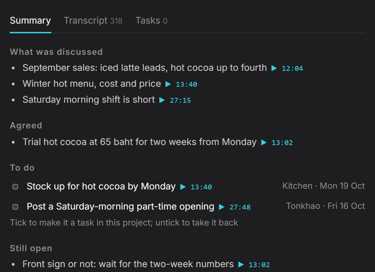
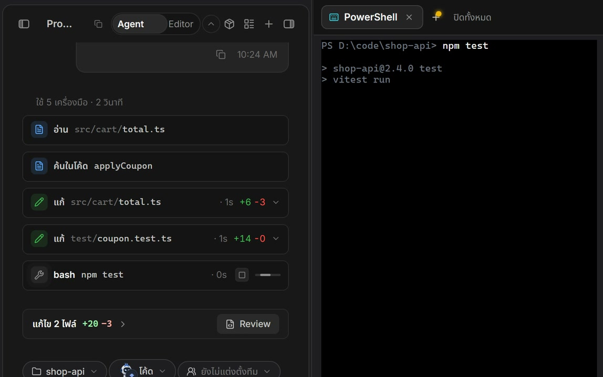
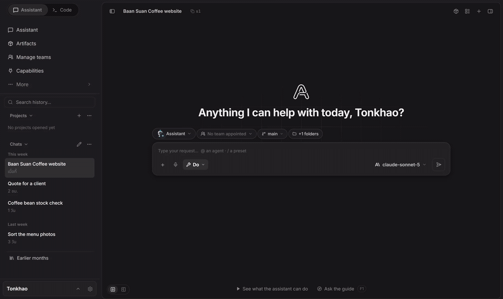
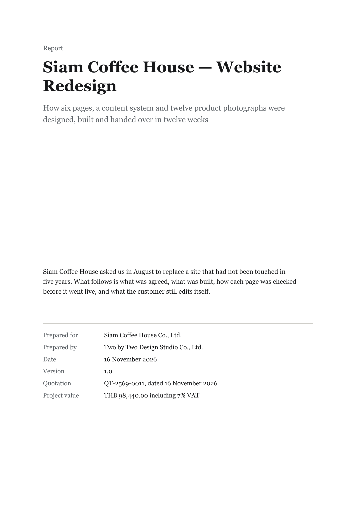
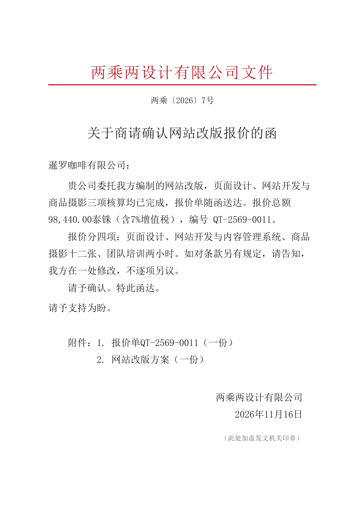
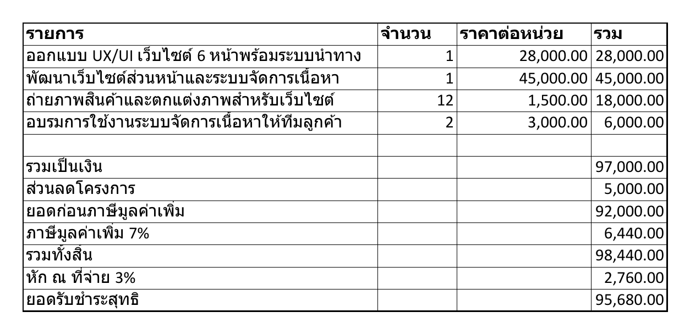

  

<h1 align="center">Aetox harness</h1>

<h3 align="center">The environment where an AI works as one system</h3>

Aetox harness is the environment that lets AI actually work on your computer — it reads the project, plans, then works
with a real terminal and a real browser, writes documents or edits code in the real project, and only says it is done
once the work has been checked. Its skills are tuned together with the harness, so the system fits together and the
model's own strengths still lead. Your data stays on your machine, and the cost goes down through the architecture that
manages context: memory is split into nodes with an index, skills and MCP tools are kept as names, and the full context
loads only for the part a job is using — so the agent reaches every skill, tool and memory without carrying all of it
in every request.

<table>
<tr>
<td width="50%" valign="top">

**Assistant**

### Fits your work — you don't fit yourself to it

> *"2 hours of meeting audio — summarise it, with who took which action"*

You get back: a summary with the topics, the decisions, and **the minute each was said at**, plus the action items
and who owns them — a file in your folder, not text in a chat box.

It knows you in parts — your profile, this machine, each desk, each worker, and the routes you repeat — so it reaches
deeper context than a general assistant, without carrying all of it in every request.

`recording meetings` · `receipts` · `tidying files` · `disk space` · `slides` · `live research` · `browser` · `automation` · `clips and content` · `teams` · `open tasks and reminders`

</td>
<td width="50%" valign="top">

**Developer**

### Code that runs — and it remembers what this project decided

It opens the real project: real files, an editor, a terminal, a language server and git. It reads the `AETOX.md`,
`AGENTS.md` or `CLAUDE.md` the project already has, runs the project's own tests before it says done, and writes down
plainly what it could not verify.

**Memory is per project** — open a folder and you get that folder's memory: your coding patterns, the decisions
already agreed, the team's conventions. Nothing needs explaining twice, and what a chat is about is pulled in when
it is needed.

**The system makes the model write better code** — that is the only thing we sell for code, not the model's own
brilliance. The model is yours; whichever one you have.

**Don't take our word for it — run it yourself.** Every task, starting file and hidden test is published.
[Run any of them](docs/reports/coding-harness-1.10.0/README.en.md) · [All the numbers, speed and tokens included →](#measured-results)

`real files` · `terminal` · `git` · `diagnostics` · `symbol` · `MCP tools` · `the project's own tests` · `sub-agents`

</td>
</tr>
</table>

  Every number is same-model, and the tasks, starting files and hidden tests are published so you can run them
  yourself. <a href="#measured-results">How it was measured, and every number</a>

  

  <strong><a href="https://github.com/Mikedev115/Aetox-Harness/releases/latest/download/aetox-amd64-installer.exe">Download the Windows installer (.exe)</a></strong>
  · <a href="https://github.com/Mikedev115/Aetox-Harness/releases/latest/download/aetox-cli-setup.exe">Aetox CLI</a>
  · <a href="#install">Scoop, portable zip and Linux</a> 
  Windows 10+ · Linux (Ubuntu 22.04+, Debian 12+) · x64 · Free to use · Bring your own model, or run one locally for free

  <a href="https://mikedev115.github.io/Aetox-landing/">Website</a> ·
  <a href="docs/release-notes/">What's new</a> ·
  <a href="docs/reports/README.md">Reports</a> ·
  <a href="README.th.md">ภาษาไทย</a> ·
  <a href="README.zh.md">中文</a> ·
  <a href="README.tr.md">Türkçe</a>

  

*Scripted walkthrough of the real app, not a benchmark run.*

## Quick start

1. **Install** from the Microsoft Store or with the installer above. Pick one channel and stay with it: the Store
   build and the installer build keep separate settings, chats and keys.
2. **Connect a model.** Open **Settings › Models** and sign in with ChatGPT, GitHub Copilot or OpenRouter, or paste
   a key, or point it at LM Studio or Ollama on your machine.
3. **Give it a job.** Pick **Assistant** for files, documents and the web, or **Code** for a project folder.

## One instruction. It works out the steps

The point is not "it can do many things". It is that you hand over one job and it works out what has to happen first,
with a real tool at every step, checking each step's result before moving on — and you see every step and can stop at
any of them.

| Step | What it does on its own |
|:---|:---|
| **1. Reads first** | Opens the project, reads the README, the database schema, how the project runs, and the documents that matter |
| **2. Plans** | Splits the job into items, says which one waits on which, and what it does not know yet |
| **3. Works step by step** | Edits files, writes migrations, runs commands, calls the MCP servers you connected, drives a real browser |
| **4. Checks its own work** | Runs the tests, reads errors from the language server, opens the page it just built and clicks through it |
| **5. Reports honestly** | What is done, what does not pass, and what it could not check |

**Jobs that really take several steps**

- *"Build a booking system for my shop"* — reads the ask as a spec → designs the database → writes the migration →
  builds the screens → runs the tests → opens a browser and books a slot itself → reports what is still missing
- *"Research five competitors and make me a comparison table"* — drives the browser across tabs, reads page by page →
  collates → writes an `.xlsx`
- *"2 hours of meeting audio, summarise it"* — transcribes → splits topics and decisions with the minute each was said →
  pulls the actions and their owners → writes the file
- *"Fix this bug"* — reads the stack trace → finds the files involved → fixes → runs the project's tests → loops back
  if it does not pass

**A job too big for one worker** — handed to a team, back as the finished set, with who did what.

## The file that leaves is the work

Two jobs people hand over every week — a document that goes out under their name, and a workbook someone else
will keep using. Neither comes back as text in a chat box.

<table>
<tr>
<td width="50%" valign="top">

**Documents**

### A page in the reader's language — Thai, English, Chinese

Ask for *"a quotation for the website job"* and it picks the page standard that language has, not a generic web page:

**Thai** — TH Sarabun New at the size the printing standard names, A4 with a 30 mm binding edge, a สารบัญ with the
หน้า column, พ.ศ. dates, 7% VAT, withholding tax stated rather than silently deducted, the total repeated in words.

**English** — A4 or Letter with one-inch margins, decimal-numbered sections, a contents page in Roman numerals, the
block letter.

**Chinese** — the GB/T 9704-2012 page: its margins, 三号仿宋 on a fixed 28 pt line, the 公文 heading levels
一、（一）1．, the parts of a 函 — and it says so when the typeface the standard names is not on the machine.

Two shapes cover nearly all of it: a report — cover, contents, sections, annexes — and a one-sheet: quotation,
letter, notice.

Then it prints the page and reads the printed file back: the fonts really embedded, no table row clipped at a page
edge, the contents page numbers read off the print instead of guessed. What comes back is the file, and nothing on
it says it was made by Aetox — it goes out under your name.

  

</td>
<td width="50%" valign="top">

**Spreadsheets**

### A workbook someone else can keep using

Numbers go in as numbers, so `SUM` returns a total and dates sort instead of sitting there as text; a value that
starts with `=` becomes a live formula; a chart is drawn from the table; a tab prints landscape, fits one page wide
and repeats its header row on every printed page.

The half that matters more: when the workbook already exists, it opens **that file** and works on it — a cell, a
styled range, rows inserted, deleted or sorted, a new tab, a dropdown or a number rule on a range, a highlight
painted by value, the formulas the file really holds — and leaves every part you did not ask about alone, instead of
rebuilding the sheet from what it happened to read and handing back a photograph of it.

</td>
</tr>
</table>

The quotation, the 函 and the workbook are this repo's own template and writer, filled and printed; the English
report page follows the same path.

## Why the same model does better

The model thinks. The environment does the rest — with real parts, not simulations.

- **Hands.** A real browser with its own tabs and profile, a real terminal, real writers for `.docx`, `.xlsx` and
  `.pptx`, and a real cut room. It does not describe the spreadsheet to you — it writes the file and opens it to look.
- **Eyes.** OCR and document readers that read a scanned page instead of asking a vision model to guess, and a page
  captured as it was instead of remembered.
- **What the model cannot know.** Skills keep it: the 1280×720 frame of a slide room, how an attacker breaks a path
  check, how a Thai tax invoice rounds, the page standard each language prints to — and how you work.
- **A check before it hands back.** It runs the tests, opens the file it made, and says plainly what it could not
  prove.

## Build an environment of your own

- **Add your own tools** — have the agent build a new one to your need
- **Teach it a skill** — a folder with a `SKILL.md`; tick it onto the desks that need it, or keep it inside one
  worker's home so the deck writer never sees the tax spec
- **Keep your prompts** — a `.md` in `prompts/` is a `/name`; one that matches a built-in replaces it, and
  `$ARGUMENTS` takes what you type after it
- **Hire a worker** — it carries its own skills, its own MCP servers and its own opening line, as files in its
  folder
- **Ship it as one pack** — one install carries skills, prompts, agents, teams, hooks, MCP servers and rooms
- **Build your own work room** — design the 3D space on the right as you like
- **Make the system look like yours** — set the background to your own style

None of it enlarges what rides on every round: names on the shelf, bodies on demand.

## Powered by Aetox Harness

The harness is the model's workbench; a skill is the manual that sits on it. When the two descriptions point the same way, the agent picks the right manual at the right moment. When they disagree, it carries the wrong one — or none at all, with the right one still on the shelf.

A context-management architecture that lets the agent extend what it can do, without carrying every detail all the time.

- A specialised tool is kept as an index; the real detail loads only when it is called
- A tool's token cost drops by up to 10×
- Tools can be added freely, without swelling the context
- Skills and specialised commands: 49 skills and 37 `/commands` ship with it, and the system names them — a line
  each in the prompt, the body only when a job opens it
- 152 MCP servers wait on a shelf, half of them labelled with what they cost in tokens before you install one;
  a server adds names, not a whole set of schemas
- Memory is split by category and by detail, so the agent reaches what it needs without loading all of it at once

**The result: the agent reaches every tool and every piece of knowledge it needs, using only the context that requires it — saving tokens, and carrying nothing it is not using.**

A skill is a guide, not a cage. It is not a rule and not a lock: it shows the model a better way to do a job, and it does not decide what the model is allowed to do. When no skill fits the moment, the model still works its own way. So there is nothing to fear about the harness capping a large model — what it adds is a floor, not a ceiling: the same job comes out the same way whether or not the model remembers how it went last time.

## It learns how you work

An environment that starts from zero every morning is a tool you rent again each day. Aetox keeps what it finds out
about you.

- **A way of working counts only when it repeats.** One day is an episode; three different days is how you work. It
  does not decide from a single conversation that this is who you are.
- **You say yes.** Anything proposed from outside a turn waits for you, and every line it keeps can be undone from
  under the answer that added it.
- **Split by who has to read it — but the work can reach all of it.** The architecture decides who reads what: your
  profile rides with every job, what it knows about this machine with the desks that need it, each room's ways with
  that room, each worker's with that worker. At work it can search the whole history, open any day's note, and pull in
  the documents on your machine — so nothing has to ride in every request, and nothing is forgotten.
- **It is a folder of plain `.md` files, not a black box.** Your profile, what it knows about this machine, each
  room's notes, one note per day of work, and the routes it has seen you repeat — written where you can open, edit,
  copy into another agent, or delete them. Nothing it learns is trapped in a format only Aetox reads.

Where it runs is your choice, and so is the model: 31 providers, cloud and local, asked for their model lists at run
time so a new model appears without a new Aetox. Today the whole of it runs on your machine.
[Every provider](https://mikedev115.github.io/Aetox-landing/features/#models)

## Measured results

**Code** — five public test suites × 2 public OpenAI models
([`gpt-6-luna`](https://developers.openai.com/api/docs/models/gpt-6-luna),
[`gpt-5.6-terra`](https://developers.openai.com/api/docs/models/gpt-5.6-terra), medium reasoning) × 3 rounds, against
four other harnesses (OpenCode · Codex CLI · omp · pi). Every task is judged by hidden tests, on the same account,
with no user settings on any of them.

| Suite | What it measures | Aetox | Best of the others |
|:---|:---|--:|--:|
| **CWEval** `func-sec@1` | Functions that both work and survive the attack tests (of 15) | **93.3%** (Luna) **97.8%** (Terra) | omp 68.9% OpenCode · omp · pi 77.8% |
| **SlopCodeBench** % tests passed | Six multi-turn tasks, checked so old code does not break | **91.6%** (Luna) **95.2%** (Terra) | OpenCode 90.8% OpenCode 92.8% |
| **SlopCodeBench** checkpoints complete | Checkpoints whose tests all pass, of 14 | **4.0 / 14** **7.0 / 14** | OpenCode 3.7 OpenCode 6.7 |
| **SWE-bench Multilingual** (caddy-6350) | A real bug from a public repo, official grading | 1/3 rounds (Luna) 2/3 rounds (Terra) | OpenCode 2/3 pi 3/3 |
| **Web-Bench** | Tasks whose Playwright spec fully passes, after 6 tasks | 5.3 / 6 5.3 / 6 | pi 5.3 omp · pi 5.7 |

The CWEval lead comes from the security skill that ships switched on — with it off, Aetox lands in the same range as
the others. And SWE-bench is the suite we do not win, which is already in this table.

**Documents and media** — measured on the same app, skills on against skills off

- **Thai slides**: **98 against 49** with the skill off
- **A video take**: 17.5 s → **11.1 s**, four silences folded and one filler cut, still editable
- **Teams**: the main agent's context **107k instead of 190k** ·
  [the whole system measured](docs/reports/WINS.md)
- **It learns you**: of 16 lines the agent proposed about its owner in three days, 4 were kept and all four were
  about the person; 0 of 8 proposals about the machine survived. That is the bar being applied, not a feature being
  advertised.

All of it is published, prompts and tests included:
[the latest coding report](docs/reports/coding-harness-1.10.0/README.en.md) ·
[skills on and off](docs/reports/SKILL-BENCH.md) · [all reports](docs/reports/README.md)

## How to use it well

Aetox has no magic that makes a model smarter — it squeezes the model's capability through architecture. Being able
to build a large system on a small model comes from that, and because of it **choosing the right model for the job
matters just as much**.

Our context architecture does not start from the question "how do we save tokens", but from "what does the model
actually need to know this round". What the system knows is mapped into a structure of its own — grouped into
categories, held as nodes linked to each other — and a run sends only the points a job touches. The prompt is
assembled per job, never handed over whole at the start, and nothing is processed that the job does not need: your
profile does not ride along on unrelated requests. Memory, skills and MCP all sit under that one architecture.

A skill's body and a tool's schema are never sent up front. The model sees a shelf of names and pays for a body only
when it opens one, so fifty skills cost what five cost, and adding an MCP server adds names, not a whole set of
schemas. Every agent can take its own skills and servers, separately.

Where a job needs the whole picture we do not make the model ask for it a slice at a time — the breadth is handed
over once, up front, and the job finishes in one turn. What rides on every round is capped instead: the tool block is
held under an **8,600-token** ceiling by a test, and a fresh install measures **26 tools / ~7,238 tokens** inside it.
The schemas of tools the job has not reached for stay on the shelf behind `tool_view` — withholding 11 of them took
the block from 12,400 to **8,600 tokens** in 1.11.0.

Work that keeps checking itself still sends its conversation again each round, and most of that is cached input at a
fraction of the price. The [1.10.0 report](docs/reports/coding-harness-1.10.0/README.en.md) is the last full
measurement of that split; it is not re-run on every release.

**The lever that decides the bill is the model, not the harness.**

- **Jobs that read a whole project, or run long** → the large model has the edge
- **Routine jobs you repeat** → the small model is enough, and the system makes up the difference
- **Everything runs on Windows** — the screen, the browser and the computer-use layer are all Win32

Rounds swing 1.5–2.5 points, so a gap of a few points reads as a tie · the method and every round are in
[the report](docs/reports/coding-harness-1.10.0/README.en.md)

## Questions that come up

**Do I need an expensive model?** — Not for every job. Aetox harness is tuned together with the skills that ship inside it, so small and mid-sized models land close to a large one. A large model slips and forgets too — which is what makes the skills worth more: the same model, fewer misses. Switch models to fit the job.

**How is this different from Claude Code or Codex?** — Nothing ties you to one provider: you switch models per job, and the system manages the context itself instead of sending everything into the model every round.

**How do I know it is actually better?** — Don't take it on trust — [the numbers](#measured-results) and the [reports](docs/reports/README.md) are published, prompts, starting files and hidden tests included. Run any task yourself.

## Inside the box

| | What it does | More |
|:---|:---|:---|
| **Developer** | Agent mode works through your project; Editor mode lets you write while it helps. Language servers, Git, a real terminal | [Code](https://mikedev115.github.io/Aetox-landing/features/#code) |
| **Assistant** | Meetings, receipts, research and data become files that open: summaries, Excel, Word, PowerPoint | [Assistant](https://mikedev115.github.io/Aetox-landing/features/#assistant) |
| **Teams** | Hand a whole job to a ready-made team; see who did what, what each handed over and what it cost | [Teams](https://mikedev115.github.io/Aetox-landing/features/#teams) |
| **Studio** | A long video becomes short clips with subtitles you keep editing | [Studio](https://mikedev115.github.io/Aetox-landing/features/#studio) |
| **Phone** | Your PC's Aetox on Android or iPhone; keys never leave the PC | [Phone setup](https://mikedev115.github.io/Aetox-landing/download/#mobile-preview) |
| **CLI** | The Code desk in your terminal, sharing the app's keys, chats and memory | [Install](#install) |

The interface ships in **English, Thai and Chinese**.

## Models

31 providers, cloud and local. ChatGPT (Codex), GitHub Copilot and OpenRouter sign in; the rest take an API key or a
local server address. LM Studio and Ollama get the same tools as a frontier model. Switch model mid-chat and the whole
context comes along.

Pictures can stay on your machine too: point Aetox at ComfyUI or Stable Diffusion WebUI (Forge Neo, Forge or A1111)
and it draws on your own GPU, FLUX.2 klein included. [Local pictures](docs/LOCAL-IMAGES.md)

> **Free to use, not free cloud inference.** Real work needs a model: an account or key you already have, or a local
> model. Your provider's pricing applies.

## Install

| Channel | Install | Updates |
|:---|:---|:---|
| **Microsoft Store** | [Store page](https://apps.microsoft.com/detail/9N4KKBRRSCZZ) or `winget install --id=9N4KKBRRSCZZ --source=msstore` | Windows updates it |
| **Installer** | [aetox-amd64-installer.exe](https://github.com/Mikedev115/Aetox-Harness/releases/latest/download/aetox-amd64-installer.exe) | In the app: **Download the update → Restart to update** |
| **Aetox CLI** | [aetox-cli-setup.exe](https://github.com/Mikedev115/Aetox-Harness/releases/latest/download/aetox-cli-setup.exe) | Per user, no admin rights, adds itself to PATH |
| **Scoop** | `scoop install https://raw.githubusercontent.com/Mikedev115/Aetox-Harness/main/scoop/aetox.json` | `scoop update aetox` |
| **Linux .deb** (Ubuntu 22.04+, Debian 12+) | `aetox_<version>_amd64.deb` from [Releases](https://github.com/Mikedev115/Aetox-Harness/releases/latest), then `sudo apt install ./aetox_*_amd64.deb` | Install the next .deb the same way; the app links to it |
| **Linux portable** | [aetox-linux-amd64-portable.tar.gz](https://github.com/Mikedev115/Aetox-Harness/releases/latest/download/aetox-linux-amd64-portable.tar.gz), unpack anywhere you can write | In the app: **Download the update → Restart to update** |

The installer is not code-signed yet, so Windows may show **"Windows protected your PC"**: choose **More info →
Run anyway**, or use the Store build, which Microsoft signs. Portable zip, antivirus notes and what to do when an
update does not take: [the update guide](docs/UPDATING.md).

## Safety and your data

- **Your data stays on your machine** — chats, files, browser data and everything it has learned live on your disk;
  no server of ours in between and no analytics. A cloud provider sees what its API normally sees.
- **Keys** are locked to your Windows account and stripped from logs and tool results.
- **You choose how much it may do** — Ask · Unsafe only · Full access. Publishing anything outside and stopping
  programs by name are asked about at every level.
- **Secret files are refused** — `.ssh`, `.aws`, Windows credential stores, browser profiles and Aetox's own key
  files cannot be opened by any tool.
- **What enforces it** — these rules are checks inside Aetox's own code, not an operating-system sandbox. For a
  machine with data you cannot lose, give Aetox an API key of its own and run it in a VM or Windows Sandbox.

[Safety in detail](https://mikedev115.github.io/Aetox-landing/safety/) · Found a security problem? [SECURITY.md](SECURITY.md) says how to report it privately.

## Where it came from

This started as a hobby in early-to-mid 2026 — I wanted an AI assistant that lives on the computer, one that works with real files, real pages and real commands, not just answers in a chat box. The idea it started from: a model fails at most things not because it cannot think, but because it has no hands, no eyes, and no memory organised into a system. So the missing parts became tools, one at a time, until they were the floor the whole thing stands on.

At first I used Claude Code and Codex for my own work. The problem was that neither could drop to a cheaper model: a job that did not need the expensive one still cost the full month. So I built the code mode on the same Aetox harness base, paid for the models out of my own pocket, and tuned the harness against the others — hunting where mine fell short and going back to fix it — until it could take software work in place of Claude Code. And nothing ties it to one provider: the model is yours to switch.

## Source, licence and who makes it

Aetox is free to use and is not open source. Install it on as many machines as you like and use it for commercial
work; do not modify, redistribute, rebrand or sell it ([LICENSE](LICENSE)). Skills, agents, prompts and MCP servers
you write are yours, and selling them is permitted (§4). The source in this repository stops at v1.7.0 and stays here
to read and audit. Later releases ship as binaries only, so the version you run has no source to read; [what you can
check without it](#safety-and-your-data). Each release lists the SHA-256 of every file in `checksums.txt`, signed with
the app's update key, and releases built after 21 Oct 2026 also carry `sbom.txt`: every Go module and web package
built into it. The Go part can be checked against the binary itself with `go version -m aetox.exe`. The Microsoft
Store build is signed by Microsoft.

Aetox is written by one person. The community lives in the [Facebook group](https://www.facebook.com/share/g/1BnXC5EiWg/) — questions and ideas go there. News and release announcements go to [Discussions](https://github.com/Mikedev115/Aetox-Harness/discussions) and [Releases](https://github.com/Mikedev115/Aetox-Harness/releases).
Bugs: [issues](https://github.com/Mikedev115/Aetox-Harness/issues) — **Settings** in the app prefills one with your
version and a log with secrets already stripped. ❤️ [Support the project](SPONSOR.md)

---

  © 2026 Chayapol Promsavana · All rights reserved · <a href="LICENSE">Licence</a> · <a href="THIRD-PARTY-NOTICES.md">Third-party notices</a>

