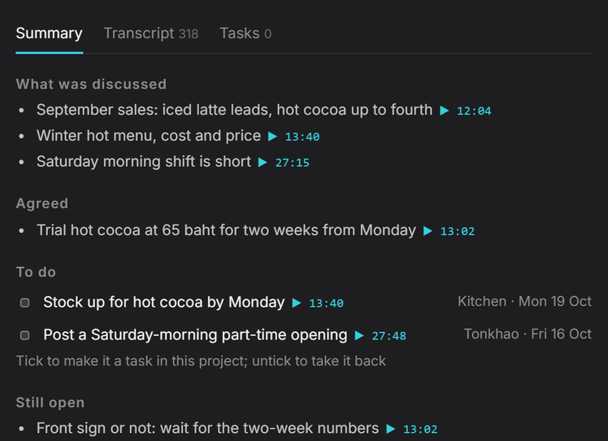
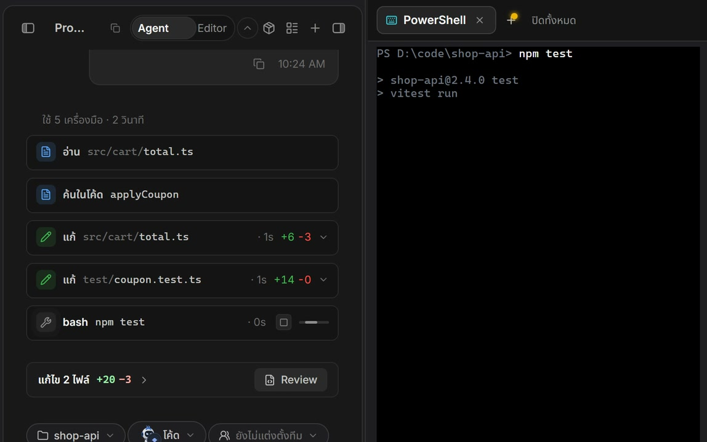
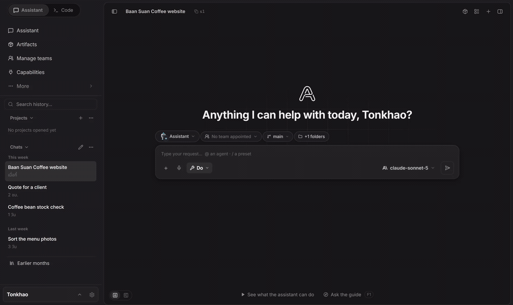
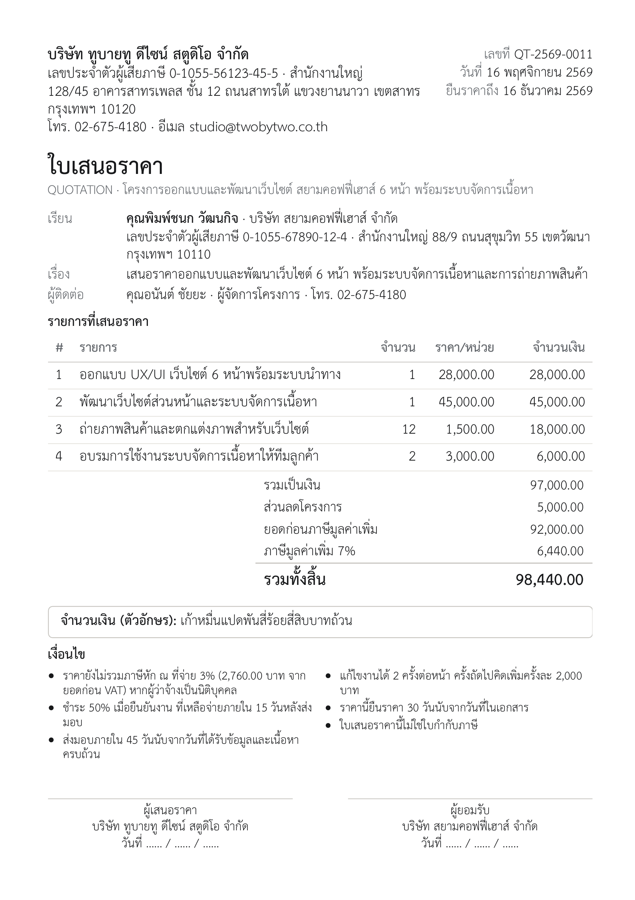
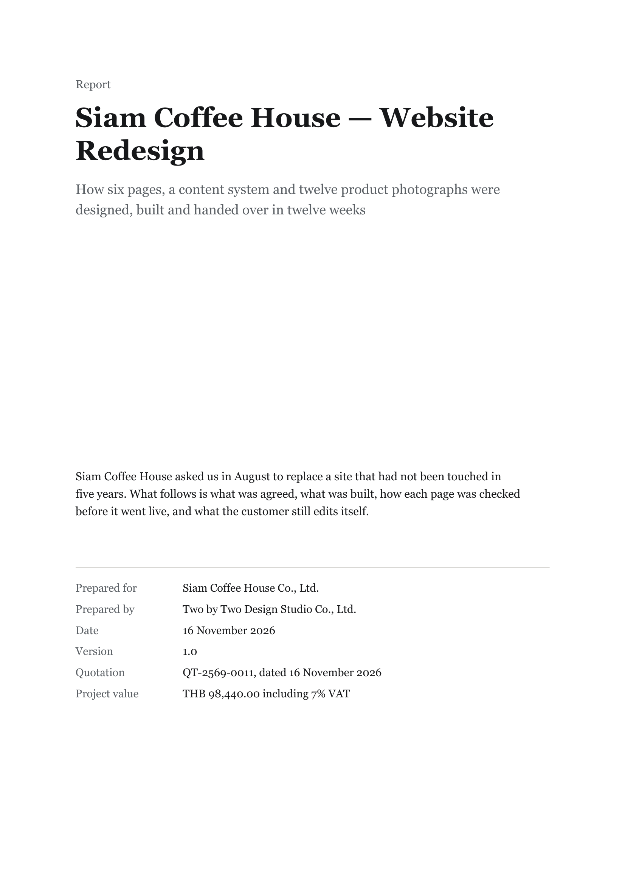
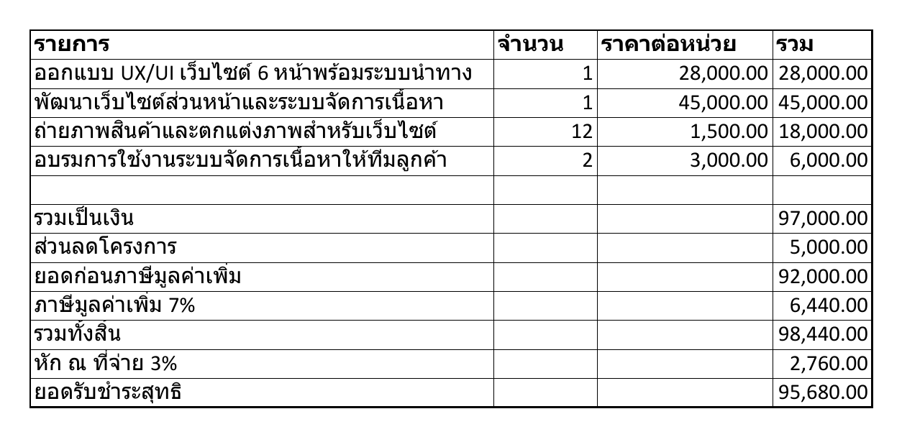

  

<h1 align="center">Aetox harness</h1>

<h3 align="center">Bir yapay zekânın tek bir sistem olarak çalıştığı ortam</h3>

Aetox harness, yapay zekânın bilgisayarınızda gerçekten çalışmasını sağlayan ortamdır — projeyi okur, planlar, ardından gerçek bir terminal ve gerçek bir tarayıcıyla çalışır, gerçek projede belgeler yazar veya kod düzenler ve yalnızca iş kontrol edildikten sonra bittiğini söyler. Becerileri (skills) harness ile birlikte ayarlanmıştır; böylece sistem bir bütün olarak uyumlu çalışır ve modelin kendi güçlü yönleri yine ön planda kalır. Verileriniz kendi makinenizde kalır ve bağlamı yöneten mimari sayesinde maliyet düşer: bellek dizinli düğümlere bölünür, beceriler ve MCP araçları ad olarak tutulur ve tam bağlam yalnızca bir işin kullandığı bölüm için yüklenir — böylece ajan her istekte tümünü taşımadan her beceriye, araca ve belleğe ulaşır.

<table>
<tr>
<td width="50%" valign="top">

**Assistant**

### İşinize uyum sağlar — siz ona uymak zorunda kalmazsınız

> *"2 saatlik toplantı ses kaydı — kimin hangi aksiyonu aldığıyla birlikte özetle"*

Geri aldığınız şey: konuları, kararları ve **her birinin kaçıncı dakikada söylendiğini** içeren bir özet, ayrıca aksiyon maddeleri ve sorumluları — sohbet kutusunda düz metin değil, klasörünüzde hazır bir dosya.

Sizi parça parça tanır — profilinizi, bu makineyi, her masayı, her çalışanı ve tekrarladığınız yolları — böylece her istekte hepsini taşımadan genel bir asistandan daha derin bağlama ulaşır.

`recording meetings` · `receipts` · `tidying files` · `disk space` · `slides` · `live research` · `browser` · `automation` · `clips and content` · `teams` · `open tasks and reminders`

</td>
<td width="50%" valign="top">

**Developer**

### Çalışan kod — ve bu projenin neye karar verdiğini hatırlar

Gerçek projeyi açar: gerçek dosyalar, bir düzenleyici, bir terminal, bir dil sunucusu ve git. Projenin hâlihazırda sahip olduğu `AETOX.md`, `AGENTS.md` veya `CLAUDE.md` dosyalarını okur, bitti demeden önce projenin kendi testlerini çalıştırır ve doğrulayamadığı şeyleri açıkça yazar.

**Bellek proje bazlıdır** — bir klasörü açtığınızda o klasörün belleğini alırsınız: kodlama kalıplarınız, üzerinde anlaşmaya varılmış kararlar, ekibin kuralları. Hiçbir şeyin iki kez açıklanmasına gerek kalmaz ve bir sohbetin neyle ilgili olduğu gerektiğinde içeri çekilir.

**Sistem modelin daha iyi kod yazmasını sağlar** — kod tarafında sunduğumuz tek şey budur, modelin kendi zekâsı değil. Model sizindir; elinizde hangisi varsa.

**Sözümüze güvenmek zorunda değilsiniz — kendiniz çalıştırın.** Her görev, başlangıç dosyası ve gizli test yayınlanmıştır.
[Herhangi birini çalıştırın](docs/reports/coding-harness-1.10.0/README.en.md) · [Hız ve token'lar dâhil tüm sayılar →](#ölçülen-sonuçlar)

`real files` · `terminal` · `git` · `diagnostics` · `symbol` · `MCP tools` · `the project's own tests` · `sub-agents`

</td>
</tr>
</table>

  Her sayı aynı modelle elde edilmiştir ve kendiniz çalıştırabilmeniz için görevler, başlangıç dosyaları ve gizli testler yayınlanmıştır. <a href="#ölçülen-sonuçlar">Nasıl ölçüldüğü ve tüm sayılar</a>

  

  <strong><a href="https://github.com/Mikedev115/Aetox-Harness/releases/latest/download/aetox-amd64-installer.exe">Windows yükleyicisini (.exe) indir</a></strong>
  · <a href="https://github.com/Mikedev115/Aetox-Harness/releases/latest/download/aetox-cli-setup.exe">Aetox CLI</a>
  · <a href="#kurulum">Scoop, taşınabilir zip ve Linux</a> 
  Windows 10+ · Linux (Ubuntu 22.04+, Debian 12+) · x64 · Kullanımı ücretsiz · Kendi modelinizi getirin veya yerel bir modeli ücretsiz çalıştırın

  <a href="https://mikedev115.github.io/Aetox-landing/">Web sitesi</a> ·
  <a href="docs/release-notes/">Yenilikler</a> ·
  <a href="docs/reports/README.md">Raporlar</a> ·
  <a href="README.md">English</a> ·
  <a href="README.th.md">ภาษาไทย</a> ·
  <a href="README.zh.md">中文</a>

  

*Gerçek uygulamanın senaryolu tanıtımıdır, bir kıyaslama (benchmark) çalıştırması değildir.*

## Hızlı başlangıç

1. Yukarıdaki yükleyiciyle veya Microsoft Store'dan **kurun**. Bir kanal seçin ve onunla devam edin: Store derlemesi ve yükleyici derlemesi ayrı ayarlar, sohbetler ve anahtarlar tutar.
2. **Bir model bağlayın.** **Settings › Models** bölümünü açın ve ChatGPT, GitHub Copilot veya OpenRouter ile oturum açın, bir anahtar yapıştırın ya da makinenizdeki LM Studio veya Ollama'ya yönlendirin.
3. **Ona bir iş verin.** Dosyalar, belgeler ve web için **Assistant**'ı veya bir proje klasörü için **Code**'u seçin.

## Tek talimat. Adımları kendisi çıkarır

Mesele "birçok şeyi yapabilmesi" değildir. Ona tek bir iş verirsiniz ve önce neyin gerçekleşmesi gerektiğini kendisi çıkarır; her adımda gerçek bir araç kullanır, bir sonraki adıma geçmeden önce her adımın sonucunu kontrol eder — ve siz her adımı görür, istediğiniz yerde durdurabilirsiniz.

| Adım | Kendi başına ne yapar |
|:---|:---|
| **1. Önce okur** | Projeyi açar, README'yi, veritabanı şemasını, projenin nasıl çalıştığını ve önemli belgeleri okur |
| **2. Planlar** | İşi maddelere böler, hangisinin hangisini beklediğini ve henüz neyi bilmediğini söyler |
| **3. Adım adım çalışır** | Dosyaları düzenler, migration'lar yazar, komutlar çalıştırır, bağladığınız MCP sunucularını çağırır, gerçek bir tarayıcıyı yönetir |
| **4. Kendi işini kontrol eder** | Testleri çalıştırır, dil sunucusundan gelen hataları okur, az önce oluşturduğu sayfayı açıp tıklayarak dener |
| **5. Dürüstçe raporlar** | Neyin bittiğini, neyin geçmediğini ve neyi kontrol edemediğini bildirir |

**Gerçekten birkaç adım süren işler**

- *"Dükkânım için bir rezervasyon sistemi kur"* — isteği teknik şartname olarak okur → veritabanını tasarlar → migration'ı yazar → ekranları oluşturur → testleri çalıştırır → bir tarayıcı açıp kendisi bir randevu alır → hâlâ nelerin eksik olduğunu raporlar
- *"Beş rakibi araştır ve bana bir karşılaştırma tablosu yap"* — tarayıcıyı sekmeler arasında sürer, sayfa sayfa okur → derler → bir `.xlsx` dosyası yazar
- *"2 saatlik toplantı ses kaydı, özetle"* — yazıya döker → her birinin söylendiği dakikayla konuları ve kararları ayırır → aksiyonları ve sorumlularını çıkarır → dosyayı yazar
- *"Bu hatayı düzelt"* — yığın izini (stack trace) okur → ilgili dosyaları bulur → düzeltir → projenin testlerini çalıştırır → geçmezse geri döner

**Tek bir çalışan için çok büyük bir iş** — bir ekibe devredilir, kimin ne yaptığıyla birlikte tamamlanmış set olarak geri döner.

## Çıkan dosya, işin kendisidir

İnsanların her hafta devrettiği iki iş — kendi adlarıyla dışarı giden bir belge ve başka birinin kullanmaya devam edeceği bir çalışma kitabı. İkisi de sohbet kutusunda metin olarak geri dönmez.

<table>
<tr>
<td width="50%" valign="top">

**Belgeler**

### Okuyucunun dilinde bir sayfa — Tayca, İngilizce, Çince

*"Web sitesi işi için bir fiyat teklifi"* istediğinizde genel bir web sayfası değil, o dilin sahip olduğu sayfa standardını seçer:

**Tayca** — Baskı standardının belirlediği boyutta TH Sarabun New, 30 mm cilt paylı A4, หน้า sütunlu bir สารบัญ, พ.ศ. tarihleri, %7 KDV, sessizce düşülmek yerine açıkça belirtilen stopaj vergisi ve yazıyla tekrarlanan toplam.

**İngilizce** — Bir inç kenar boşluklu A4 veya Letter, ondalık numaralı bölümler, Romen rakamlı içindekiler sayfası, blok mektup düzeni.

**Çince** — GB/T 9704-2012 sayfası: kenar boşlukları, sabit 28 pt satır aralığında 三号仿宋, 一、（一）1． biçiminde 公文 başlık düzeyleri, bir 函'ın bölümleri — ve standardın adlandırdığı yazı tipi makinede yoksa bunu söyler.

İki biçim neredeyse hepsini kapsar: bir rapor — kapak, içindekiler, bölümler, ekler — ve tek sayfalık bir belge: fiyat teklifi, mektup, duyuru.

Ardından sayfayı yazdırır ve yazdırılan dosyayı geri okur: yazı tipleri gerçekten gömülü mü, sayfa kenarında kesilmiş tablo satırı var mı, içindekiler sayfa numaraları tahmin edilmek yerine çıktıdan mı okunmuş. Geri dönen şey dosyanın kendisidir ve üzerinde Aetox tarafından yapıldığına dair hiçbir şey yazmaz — sizin adınızla çıkar.

  

</td>
<td width="50%" valign="top">

**Elektronik tablolar**

### Başka birinin kullanmaya devam edebileceği bir çalışma kitabı

Sayılar sayı olarak girer, böylece `SUM` toplamı döndürür ve tarihler metin olarak durmak yerine sıralanır; `=` ile başlayan bir değer canlı bir formüle dönüşür; tablodan bir grafik çizilir; bir sekme yatay yazdırılır, tek sayfa genişliğine sığdırılır ve yazdırılan her sayfada başlık satırını yineler.

Daha önemli olan kısım: çalışma kitabı zaten mevcut olduğunda **o dosyayı** açar ve onun üzerinde çalışır — bir hücre, biçimlendirilmiş bir aralık, eklenen, silinen veya sıralanan satırlar, yeni bir sekme, bir aralıkta açılır liste veya sayı kuralı, değere göre boyanmış bir vurgu, dosyanın gerçekten tuttuğu formüller — ve sayfayı okuyabildiği kadarıyla baştan kurup size bir fotoğrafını vermek yerine, sormadığınız her bölüme dokunmadan bırakır.

</td>
</tr>
</table>

Fiyat teklifi, 函 ve çalışma kitabı bu deponun kendi şablonu ve yazıcısıdır, doldurulmuş ve yazdırılmıştır; İngilizce rapor sayfası da aynı yolu izler.

## Aynı model neden daha iyi iş çıkarır

Model düşünür. Gerisini ortam yapar — simülasyonlarla değil, gerçek parçalarla.

- **Eller.** Kendi sekmelerine ve profiline sahip gerçek bir tarayıcı, gerçek bir terminal, `.docx`, `.xlsx` ve `.pptx` için gerçek yazıcılar ve gerçek bir kurgu odası. Size elektronik tabloyu tarif etmez — dosyayı yazar ve bakmak için açar.
- **Gözler.** Bir görsel modelin tahmin etmesini istemek yerine taranmış bir sayfayı okuyan OCR ve belge okuyucuları ve hatırlanan değil, olduğu gibi yakalanan bir sayfa.
- **Modelin bilemeyeceği şeyler.** Beceriler bunu saklar: bir slayt odasının 1280×720 çerçevesi, bir saldırganın yol kontrolünü nasıl kırdığı, bir Tayland vergi faturasının nasıl yuvarlandığı, her dilin hangi sayfa standardına göre basıldığı — ve sizin nasıl çalıştığınız.
- **Teslim etmeden önce bir kontrol.** Testleri çalıştırır, oluşturduğu dosyayı açar ve kanıtlayamadığı şeyleri açıkça söyler.

## Kendi ortamınızı kurun

- **Kendi araçlarınızı ekleyin** — ajanın ihtiyacınıza göre yeni bir araç oluşturmasını sağlayın
- **Ona bir beceri öğretin** — içinde `SKILL.md` bulunan bir klasör; ihtiyaç duyan masalara işaretleyin veya sunum yazarının vergi şartnamesini hiç görmemesi için tek bir çalışanın evinde tutun
- **İstemlerinizi saklayın** — `prompts/` içindeki bir `.md` dosyası bir `/name` komutudur; yerleşik bir komutla eşleşen onun yerini alır ve `$ARGUMENTS` ardından yazdıklarınızı alır
- **Bir çalışan işe alın** — kendi klasöründeki dosyalar olarak kendi becerilerini, kendi MCP sunucularını ve kendi açılış satırını taşır
- **Tek paket olarak dağıtın** — tek bir kurulum becerileri, istemleri, ajanları, ekipleri, kancaları (hooks), MCP sunucularını ve odaları taşır
- **Kendi çalışma odanızı kurun** — sağdaki 3B alanı istediğiniz gibi tasarlayın
- **Sistemin size benzemesini sağlayın** — arka planı kendi tarzınıza göre ayarlayın

Bunların hiçbiri her turda taşınan yükü büyütmez: rafta adlar, ihtiyaç duyulduğunda gövdeler.

## Aetox Harness ile güçlendirilmiştir

Harness modelin çalışma tezgâhıdır; beceri ise onun üzerinde duran el kitabıdır. İki açıklama aynı yönü gösterdiğinde ajan doğru anda doğru el kitabını seçer. Anlaşamadıklarında yanlış olanı taşır — ya da doğru olan hâlâ raftayken hiçbirini taşımaz.

Ajanın her zaman her ayrıntıyı taşımadan yapabileceklerini genişletmesine olanak tanıyan bir bağlam yönetimi mimarisi.

- Özelleşmiş bir araç dizin olarak tutulur; gerçek ayrıntı yalnızca çağrıldığında yüklenir
- Bir aracın token maliyeti 10 kata kadar düşer
- Araçlar bağlamı şişirmeden serbestçe eklenebilir
- Beceriler ve özelleşmiş komutlar: 49 beceri ve 37 `/commands` ile birlikte gelir ve sistem bunları adlandırır — istemde her biri için bir satır, gövde ise yalnızca bir iş onu açtığında
- 152 MCP sunucusu bir rafta bekler, yarısı birini kurmadan önce token cinsinden maliyetini etiketler; bir sunucu tüm bir şema setini değil, adları ekler
- Bellek kategoriye ve ayrıntıya göre bölünür, böylece ajan hepsini bir kerede yüklemeden ihtiyaç duyduğuna ulaşır

**Sonuç: ajan yalnızca gerektirdiği bağlamı kullanarak ihtiyaç duyduğu her araca ve her bilgi parçasına ulaşır — token tasarrufu sağlar ve kullanmadığı hiçbir şeyi taşımaz.**

Bir beceri bir kafes değil, bir rehberdir. Bir kural veya kilit değildir: modele bir işi yapmanın daha iyi bir yolunu gösterir ve modelin ne yapmasına izin verildiğine karar vermez. O ana uyan bir beceri olmadığında model yine kendi bildiği gibi çalışır. Dolayısıyla harness'ın büyük bir modeli kısıtlamasından korkmaya gerek yoktur — eklediği şey bir tavan değil, bir tabandır: model geçen sefer nasıl gittiğini hatırlasa da hatırlamasa da aynı iş aynı şekilde çıkar.

## Nasıl çalıştığınızı öğrenir

Her sabah sıfırdan başlayan bir ortam, her gün yeniden kiraladığınız bir araçtır. Aetox sizin hakkınızda öğrendiklerini saklar.

- **Bir çalışma biçimi yalnızca tekrarlandığında sayılır.** Tek bir gün bir olaydır; üç farklı gün ise sizin çalışma biçiminizdir. Tek bir sohbetten sizin kim olduğunuza karar vermez.
- **Evet diyen sizsiniz.** Bir tur dışından önerilen her şey onayınızı bekler ve tuttuğu her satır onu ekleyen yanıtın altından geri alınabilir.
- **Kimin okuması gerektiğine göre bölünür — ancak iş hepsine ulaşabilir.** Mimari kimin neyi okuyacağına karar verir: profiliniz her işle birlikte gider, bu makine hakkında bildikleri ihtiyaç duyan masalarla, her odanın yöntemleri o odayla, her çalışanınki o çalışanla. İş başında tüm geçmişi arayabilir, herhangi bir günün notunu açabilir ve makinenizdeki belgeleri içeri çekebilir — böylece hiçbir şeyin her istekte taşınması gerekmez ve hiçbir şey unutulmaz.
- **Bir kara kutu değil, düz `.md` dosyalarından oluşan bir klasördür.** Profiliniz, bu makine hakkında bildikleri, her odanın notları, her çalışma günü için bir not ve tekrarladığınızı gördüğü yollar — açabileceğiniz, düzenleyebileceğiniz, başka bir ajana kopyalayabileceğiniz veya silebileceğiniz bir yere yazılır. Öğrendiği hiçbir şey yalnızca Aetox'un okuyabildiği bir biçimde hapsedilmez.

Nerede çalışacağı sizin seçiminizdir, model de öyle: çalışma zamanında model listeleri sorulan bulut ve yerel 31 sağlayıcı, böylece yeni bir Aetox olmadan yeni bir model görünür. Bugün tamamı kendi makinenizde çalışır.
[Tüm sağlayıcılar](https://mikedev115.github.io/Aetox-landing/features/#models)

## Ölçülen sonuçlar

**Kod** — beş herkese açık test paketi × 2 herkese açık OpenAI modeli
([`gpt-6-luna`](https://developers.openai.com/api/docs/models/gpt-6-luna),
[`gpt-5.6-terra`](https://developers.openai.com/api/docs/models/gpt-5.6-terra), orta düzey akıl yürütme) × 3 tur, dört diğer harness'a karşı (OpenCode · Codex CLI · omp · pi). Her görev aynı hesapta, hiçbirinde kullanıcı ayarı olmadan gizli testlerle değerlendirilir.

| Paket | Ne ölçer | Aetox | Diğerlerinin en iyisi |
|:---|:---|--:|--:|
| **CWEval** `func-sec@1` | Hem çalışan hem de saldırı testlerinden sağ çıkan işlevler (15 üzerinden) | **%93,3** (Luna) **%97,8** (Terra) | omp %68,9 OpenCode · omp · pi %77,8 |
| **SlopCodeBench** % geçilen test | Eski kodun bozulmaması için kontrol edilen altı çok turlu görev | **%91,6** (Luna) **%95,2** (Terra) | OpenCode %90,8 OpenCode %92,8 |
| **SlopCodeBench** tamamlanan kontrol noktası | Tüm testleri geçen kontrol noktaları (14 üzerinden) | **4,0 / 14** **7,0 / 14** | OpenCode 3,7 OpenCode 6,7 |
| **SWE-bench Multilingual** (caddy-6350) | Herkese açık bir depodan gerçek bir hata, resmî puanlama | 1/3 tur (Luna) 2/3 tur (Terra) | OpenCode 2/3 pi 3/3 |
| **Web-Bench** | 6 görev sonrasında Playwright spesifikasyonu tamamen geçen görevler | 5,3 / 6 5,3 / 6 | pi 5,3 omp · pi 5,7 |

CWEval liderliği varsayılan olarak açık gelen güvenlik becerisinden kaynaklanır — kapalı olduğunda Aetox diğerleriyle aynı aralığa düşer. SWE-bench ise kazanamadığımız pakettir ve bu tabloda zaten yer almaktadır.

**Belgeler ve medya** — aynı uygulamada ölçüldü, beceriler açık vs beceriler kapalı

- **Tayca slaytlar**: beceri kapalıyken 49'a karşı **98**
- **Bir video çekimi**: 17,5 s → **11,1 s**, dört sessizlik katlandı ve bir dolgu sözcüğü kesildi, hâlâ düzenlenebilir
- **Ekipler**: ana ajanın bağlamı 190k yerine **107k** ·
  [tüm sistem ölçümleri](docs/reports/WINS.md)
- **Sizi öğrenir**: ajanın üç günde sahibi hakkında önerdiği 16 satırdan 4'ü tutuldu ve dördü de kişi hakkındaydı; makine hakkındaki 8 öneriden 0'ı kaldı. Bu, reklamı yapılan bir özellik değil, uygulanan çıtadır.

İstemler ve testler dâhil tümü yayınlanmıştır:
[en son kodlama raporu](docs/reports/coding-harness-1.10.0/README.en.md) ·
[beceriler açık ve kapalı](docs/reports/SKILL-BENCH.md) · [tüm raporlar](docs/reports/README.md)

## Nasıl iyi kullanılır

Aetox'un bir modeli daha akıllı yapan bir büyüsü yoktur — modelin kapasitesini mimari aracılığıyla sonuna kadar kullanır. Küçük bir model üzerinde büyük bir sistem kurabilmek bundan kaynaklanır ve bu nedenle **iş için doğru modeli seçmek de bir o kadar önemlidir**.

Bağlam mimarimiz "token'ları nasıl kurtarırız" sorusundan değil, "modelin bu turda gerçekten neyi bilmesi gerekiyor" sorusundan yola çıkar. Sistemin bildikleri kendi yapısına göre eşlenir — kategorilere ayrılır, birbirine bağlı düğümler olarak tutulur — ve bir çalıştırma yalnızca işin dokunduğu noktaları gönderir. İstem iş başına derlenir, başlangıçta asla bütünüyle verilmez ve işin ihtiyaç duymadığı hiçbir şey işlenmez: profiliniz ilgisiz isteklere eklenmez. Bellek, beceriler ve MCP'nin tamamı bu tek mimarinin altında yer alır.

Bir becerinin gövdesi ve bir aracın şeması asla peşin gönderilmez. Model bir adlar rafı görür ve yalnızca birini açtığında gövde için ödeme yapar; bu yüzden elli beceri beş beceriyle aynı maliyete sahiptir ve bir MCP sunucusu eklemek tüm bir şema setini değil, adları ekler. Her ajan kendi becerilerini ve sunucularını ayrı ayrı alabilir.

Bir işin büyük resme ihtiyaç duyduğu yerlerde modelin bunu dilim dilim istemesini beklemeyiz — genişlik en başta bir kez verilir ve iş tek turda biter. Her turda taşınan kısım ise sınırlandırılmıştır: araç bloğu bir testle **8.600 token** tavanının altında tutulur ve temiz bir kurulum bunun içinde **26 araç / ~7.238 token** ölçer. İşin henüz uzanmadığı araçların şemaları `tool_view` arkasındaki rafta kalır — bunlardan 11'ini tutmak 1.11.0 sürümünde bloğu 12.400'den **8.600 token**'a düşürmüştür.

Kendini kontrol etmeye devam eden işler yine her turda konuşmasını yeniden gönderir ve bunun çoğu maliyetin çok küçük bir kısmıyla önbelleğe alınmış girdidir. [1.10.0 raporu](docs/reports/coding-harness-1.10.0/README.en.md) bu dağılımın son tam ölçümüdür; her sürümde yeniden çalıştırılmaz.

**Faturayı belirleyen kaldıraç harness değil, modeldir.**

- **Tüm projeyi okuyan veya uzun süren işler** → büyük model avantajlıdır
- **Tekrarladığınız rutin işler** → küçük model yeterlidir ve sistem aradaki farkı kapatır
- **Her şey Windows üzerinde çalışır** — ekran, tarayıcı ve bilgisayar kullanım katmanının tamamı Win32'dir

Turlar 1,5–2,5 puan oynar, bu nedenle birkaç puanlık bir fark beraberlik olarak okunur · yöntem ve her tur [raporun](docs/reports/coding-harness-1.10.0/README.en.md) içindedir

## Sık sorulan sorular

**Pahalı bir modele ihtiyacım var mı?** — Her iş için değil. Aetox harness içinde gelen becerilerle birlikte ayarlanmıştır, bu nedenle küçük ve orta ölçekli modeller büyük bir modele yakın sonuç verir. Büyük bir model de hata yapar ve unutur — becerileri daha değerli kılan da budur: aynı model, daha az ıska. İşe göre model değiştirin.

**Bunun Claude Code veya Codex'ten farkı nedir?** — Hiçbir şey sizi tek bir sağlayıcıya bağlamaz: iş başına model değiştirirsiniz ve sistem her turda her şeyi modele göndermek yerine bağlamı kendisi yönetir.

**Gerçekten daha iyi olduğunu nasıl bileceğim?** — Söze inanmayın — [sayılar](#ölçülen-sonuçlar) ve [raporlar](docs/reports/README.md) istemler, başlangıç dosyaları ve gizli testler dâhil yayınlanmıştır. Herhangi bir görevi kendiniz çalıştırın.

## Kutunun içinde neler var

| | Ne yapar | Daha fazla |
|:---|:---|:---|
| **Developer** | Agent modu projeniz üzerinde çalışır; Editor modu o yardım ederken sizin yazmanıza izin verir. Dil sunucuları, Git, gerçek bir terminal | [Code](https://mikedev115.github.io/Aetox-landing/features/#code) |
| **Assistant** | Toplantılar, fişler, araştırmalar ve veriler açılan dosyalara dönüşür: özetler, Excel, Word, PowerPoint | [Assistant](https://mikedev115.github.io/Aetox-landing/features/#assistant) |
| **Teams** | Tüm bir işi hazır bir ekibe devredin; kimin ne yaptığını, her birinin ne teslim ettiğini ve maliyetini görün | [Teams](https://mikedev115.github.io/Aetox-landing/features/#teams) |
| **Studio** | Uzun bir video düzenlemeye devam edebileceğiniz altyazılı kısa kliplere dönüşür | [Studio](https://mikedev115.github.io/Aetox-landing/features/#studio) |
| **Phone** | Android veya iPhone üzerinde bilgisayarınızın Aetox'u; anahtarlar asla bilgisayardan çıkmaz | [Phone setup](https://mikedev115.github.io/Aetox-landing/download/#mobile-preview) |
| **CLI** | Uygulamanın anahtarlarını, sohbetlerini ve belleğini paylaşarak terminalinizdeki Code masası | [Kurulum](#kurulum) |

Arayüz **İngilizce, Tayca ve Çince** dillerinde gelir.

## Modeller

Bulut ve yerel olmak üzere 31 sağlayıcı. ChatGPT (Codex), GitHub Copilot ve OpenRouter oturum açar; geri kalanı bir API anahtarı veya yerel sunucu adresi alır. LM Studio ve Ollama öncü bir modelle aynı araçları alır. Sohbet ortasında model değiştirin ve tüm bağlam onunla birlikte gelsin.

Görseller de makinenizde kalabilir: Aetox'u ComfyUI veya Stable Diffusion WebUI'ya (Forge Neo, Forge veya A1111) yönlendirin ve FLUX.2 klein dâhil kendi GPU'nuzda çizsin. [Yerel görseller](docs/LOCAL-IMAGES.md)

> **Kullanımı ücretsizdir, ücretsiz bulut çıkarımı değildir.** Gerçek iş bir model gerektirir: hâlihazırda sahip olduğunuz bir hesap veya anahtar ya da yerel bir model. Sağlayıcınızın fiyatlandırması geçerlidir.

## Kurulum

| Kanal | Kurulum | Güncellemeler |
|:---|:---|:---|
| **Microsoft Store** | [Mağaza sayfası](https://apps.microsoft.com/detail/9N4KKBRRSCZZ) veya `winget install --id=9N4KKBRRSCZZ --source=msstore` | Windows günceller |
| **Yükleyici** | [aetox-amd64-installer.exe](https://github.com/Mikedev115/Aetox-Harness/releases/latest/download/aetox-amd64-installer.exe) | Uygulama içinde: **Download the update → Restart to update** |
| **Aetox CLI** | [aetox-cli-setup.exe](https://github.com/Mikedev115/Aetox-Harness/releases/latest/download/aetox-cli-setup.exe) | Kullanıcı başına, yönetici izni gerekmez, kendini PATH'e ekler |
| **Scoop** | `scoop install https://raw.githubusercontent.com/Mikedev115/Aetox-Harness/main/scoop/aetox.json` | `scoop update aetox` |
| **Linux .deb** (Ubuntu 22.04+, Debian 12+) | [Releases](https://github.com/Mikedev115/Aetox-Harness/releases/latest) sayfasından `aetox_<version>_amd64.deb`, ardından `sudo apt install ./aetox_*_amd64.deb` | Bir sonraki .deb dosyasını aynı şekilde kurun; uygulama ona bağlantı verir |
| **Linux taşınabilir** | [aetox-linux-amd64-portable.tar.gz](https://github.com/Mikedev115/Aetox-Harness/releases/latest/download/aetox-linux-amd64-portable.tar.gz), yazabildiğiniz herhangi bir yere açın | Uygulama içinde: **Download the update → Restart to update** |

Yükleyici henüz kod imzalı değildir, bu nedenle Windows **"Windows kişisel bilgisayarınızı korudu"** uyarısını gösterebilir: **Ek bilgi → Yine de çalıştır** seçeneğini seçin veya Microsoft tarafından imzalanan Store derlemesini kullanın. Taşınabilir zip, antivirüs notları ve bir güncelleme uygulanmadığında yapılacaklar: [güncelleme rehberi](docs/UPDATING.md).

## Güvenlik ve verileriniz

- **Verileriniz makinenizde kalır** — sohbetler, dosyalar, tarayıcı verileri ve öğrendiği her şey diskinizde yaşar; arada bizim bir sunucumuz yoktur ve analitik bulunmaz. Bir bulut sağlayıcısı API'sinin normalde gördüğünü görür.
- **Anahtarlar** Windows hesabınıza kilitlenir ve günlüklerden ile araç sonuçlarından temizlenir.
- **Ne kadarını yapabileceğini siz seçersiniz** — Ask · Unsafe only · Full access. Dışarıya bir şey yayınlamak ve programları ada göre durdurmak her düzeyde sorulur.
- **Gizli dosyalar reddedilir** — `.ssh`, `.aws`, Windows kimlik bilgisi depoları, tarayıcı profilleri ve Aetox'un kendi anahtar dosyaları hiçbir araç tarafından açılamaz.
- **Bunu ne uygular** — bu kurallar bir işletim sistemi korumalı alanı değil, Aetox'un kendi kodu içindeki kontrollerdir. Kaybedemeyeceğiniz verilerin bulunduğu bir makine için Aetox'a kendi API anahtarını verin ve onu bir VM veya Windows Sandbox içinde çalıştırın.

[Ayrıntılı güvenlik](https://mikedev115.github.io/Aetox-landing/safety/) · Bir güvenlik sorunu mu buldunuz? [SECURITY.md](SECURITY.md) bunu gizli olarak nasıl bildireceğinizi anlatır.

## Nereden çıktı

Bu, 2026'nın başı ile ortasında bir hobi olarak başladı — yalnızca sohbet kutusunda yanıtlar veren değil, gerçek dosyalarla, gerçek sayfalarla ve gerçek komutlarla çalışan, bilgisayarda yaşayan bir yapay zekâ asistanı istedim. Başladığı fikir şuydu: bir model çoğu şeyde düşünemediği için değil, elleri, gözleri ve bir sistem hâlinde düzenlenmiş belleği olmadığı için başarısız olur. Böylece eksik parçalar, her şeyin üzerinde durduğu zemin olana kadar birer birer araçlara dönüştü.

Başlangıçta kendi işlerim için Claude Code ve Codex kullandım. Sorun ikisinin de daha ucuz bir modele düşememesiydi: pahalı olana ihtiyaç duymayan bir iş bile tam aylık maliyete çıkıyordu. Bu yüzden aynı Aetox harness tabanı üzerine kod modunu kurdum, modellerin ücretini kendi cebimden ödedim ve harness'ı diğerlerine karşı ayarladım — benimkinin nerede eksik kaldığını avlayıp düzeltmek için geri dönerek — ta ki Claude Code yerine yazılım işlerini üstlenebilene kadar. Ve hiçbir şey onu tek bir sağlayıcıya bağlamaz: değiştirmek için model sizindir.

## Kaynak kodu, lisans ve kim yapıyor

Aetox'un kullanımı ücretsizdir ve açık kaynak değildir. İstediğiniz kadar makineye kurun ve ticari işler için kullanın; değiştirmeyin, yeniden dağıtmayın, yeniden markalamayın veya satmayın ([LICENSE](LICENSE)). Yazdığınız beceriler, ajanlar, istemler ve MCP sunucuları sizindir ve bunların satılmasına izin verilir (§4). Bu depodaki kaynak kodu v1.7.0 sürümünde durur ve okunup denetlenmek üzere burada kalır. Sonraki sürümler yalnızca ikili dosya olarak gelir, bu nedenle çalıştırdığınız sürümün okunacak kaynak kodu yoktur; [onsuz neleri kontrol edebilirsiniz](#güvenlik-ve-verileriniz). Her sürüm `checksums.txt` içinde uygulamanın güncelleme anahtarıyla imzalanmış her dosyanın SHA-256 değerini listeler ve 21 Ekim 2026 sonrası derlenen sürümler ayrıca `sbom.txt` taşır: içine derlenen her Go modülü ve web paketi. Go kısmı `go version -m aetox.exe` komutuyla ikili dosyanın kendisine karşı kontrol edilebilir. Microsoft Store derlemesi Microsoft tarafından imzalanmıştır.

Aetox tek bir kişi tarafından yazılmaktadır. Topluluk [Facebook grubunda](https://www.facebook.com/share/g/1BnXC5EiWg/) yaşar — sorular ve fikirler oraya gider. Haberler ve sürüm duyuruları [Discussions](https://github.com/Mikedev115/Aetox-Harness/discussions) ve [Releases](https://github.com/Mikedev115/Aetox-Harness/releases) bölümlerine gider.
Hatalar: [issues](https://github.com/Mikedev115/Aetox-Harness/issues) — uygulamadaki **Settings** bölümü, sürümünüz ve gizli bilgileri zaten temizlenmiş bir günlükle bir tane önceden doldurur. ❤️ [Projeyi destekle](SPONSOR.md)

---

  © 2026 Chayapol Promsavana · Tüm hakları saklıdır · <a href="LICENSE">Lisans</a> · <a href="THIRD-PARTY-NOTICES.md">Üçüncü taraf bildirimleri</a>

