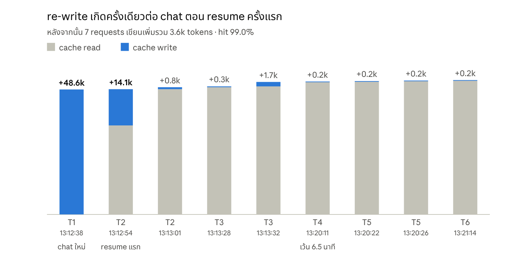

# Claude Code ผ่าน Aetox: prompt cache แตกไหม

> **วัดเมื่อ:** 21 ต.ค. 2026 · Claude Code 2.1.295 · Windows 11
> **คำตอบ:** ไม่แตก Aetox ส่ง input ให้ Claude Code เหมือนเดิมทุก byte ในทุก turn และ cache hit เต็มทุก request ยกเว้นครั้งเดียวต่อ chat คือ `--resume` ครั้งแรก ซึ่ง re-write ราว 14k tokens ส่วนนี้เป็นพฤติกรรมของ Claude Code เอง เพราะ `claude` เปล่าที่ไม่ผ่าน Aetox ก็เป็นเหมือนกัน
> **แจ้ง Anthropic แล้ว:** [anthropics/claude-code#99833](https://github.com/anthropics/claude-code/issues/99833#issuecomment-6309681424)

Aetox รัน Claude Code แบบเปิด process ใหม่ทุก turn แล้วต่อ chat เดิมด้วย `--resume` จุดนี้จึงเสี่ยงที่สุด เพราะถ้า prompt ที่ส่งไปต่างจาก turn ก่อนแม้แต่นิดเดียว cache จะแตก และต้องจ่ายค่าเขียน cache ใหม่ทั้งก้อน

## Live probe ผ่าน Aetox



ตั้งค่า probe แบบนี้: Sonnet 5.5, mode Auto, เปิด MCP ของ Aetox และส่ง 6 ข้อความผ่าน engine ของ Aetox เว้นระยะ 5 วินาที / 20 วินาที / 6.5 นาที / 3 วินาที / 40 วินาที แต่ละบรรทัดใน log คือ 1 request ไป API ทุก request เขียน cache ลง tier 1h

```text
turn 1  13:12:33  (chat ใหม่)
  13:12:38 claude-sonnet-5-5 in=2 cache_read=0     cache_write=48646
turn 2  13:12:50  (resume ครั้งแรก)
  13:12:54 claude-sonnet-5-5 in=2 cache_read=34650 cache_write=14108   <- จุดเดียวที่ re-write
  13:13:01 claude-sonnet-5-5 in=2 cache_read=48758 cache_write=764
turn 3  13:13:26
  13:13:28 claude-sonnet-5-5 in=2 cache_read=49522 cache_write=325
  13:13:32 claude-sonnet-5-5 in=2 cache_read=49847 cache_write=1725
turn 4  13:20:08  (เว้น 6.5 นาที เกิน TTL 5 นาที)
  13:20:11 claude-sonnet-5-5 in=2 cache_read=51572 cache_write=161     <- ยัง hit เต็ม
turn 5  13:20:19
  13:20:22 claude-sonnet-5-5 in=2 cache_read=51708 cache_write=193
  13:20:26 claude-sonnet-5-5 in=2 cache_read=51901 cache_write=217
turn 6  13:21:11
  13:21:14 claude-sonnet-5-5 in=2 cache_read=52118 cache_write=172
```

ก่อน `claude.exe` ใน PATH เราวาง shim ตัวเล็กไว้ เพื่อ log argv ที่ Aetox ส่งในแต่ละ turn แล้วเทียบทีละ flag กับ turn แรก ผลคือ `--append-system-prompt`, `--agents`, `--mcp-config`, `--model` และ `--permission-mode` ตรงกันทุก byte ต่างกันแค่ `--session-id` กับ `--resume` ตามที่ควรเป็น

```text
turn 1  --session-id=91a45c29-...
turn 2  --resume=91a45c29-...   changed flags vs turn 1: none
turn 3  --resume=91a45c29-...   changed flags vs turn 1: none
```

## เทียบกับ claude เปล่า

รัน `claude -p --output-format=json` 3 ครั้งติดกันในโฟลเดอร์เปล่า โดยไม่ผ่าน Aetox ครั้งแรกใช้ `--session-id` ส่วนครั้งที่ 2–3 ใช้ `--resume` ตัวเลขเป็น tokens

| Model | ครั้งที่ 1 read / write | ครั้งที่ 2 (resume ครั้งแรก) read / write | ครั้งที่ 3 read / write |
|---|---|---|---|
| Sonnet 5.5 | 27,441 / 16,473 | 30,180 / **13,778** | 43,933 / 69 |
| Haiku 5.5 | 0 / 44,688 | 30,959 / **13,769** | 44,703 / 65 |
| Opus 5.5 | 0 / 43,513 | 43,513 / 104 | 43,617 / 43 |

Sonnet กับ Haiku re-write ราว 13.8k ตอน resume ครั้งแรก แทบเท่ากับที่เจอใน Aetox (14.1k) ส่วน Opus ไม่ re-write ในรอบนี้

## Chats จริงย้อนหลัง

ย้อนดู chat ที่ใช้ Claude Code ใน Aetox ตั้งแต่ 9 ต.ค. ได้ 12 chats มี 95 requests ที่ตามหลัง request แรกของ chat และ miss แค่ 1 ครั้ง ซึ่งเป็นการ resume ครั้งแรกบน Sonnet เหมือนกับที่ probe เจอ ค่า hit รวม request แรกที่ต้องเขียน prefix ไว้ด้วย chat สั้นจึงได้ค่าต่ำกว่า

| วันที่ | Model | Requests | Cache hit | Miss |
|---|---|---|---|---|
| 21 ต.ค. | Opus 5.5 | 4 | 85.0% | 0 |
| 20 ต.ค. | Opus 5.5 | 19 | 95.9% | 0 |
| 20 ต.ค. | Opus 5.5 | 41 | 96.3% | 0 |
| 18 ต.ค. | Opus 5.5 | 9 | 88.7% | 0 |
| 18 ต.ค. | Opus 5.5 | 8 | 92.3% | 0 |
| 17 ต.ค. | Opus 5.5 | 4 | 80.8% | 0 |
| 12 ต.ค. | Sonnet 5.5 | 5 | 81.1% | 1 (re-write 14,116) |
| 9 ต.ค. | Haiku 5.5 | 9 | 89.2% | 0 |
| 9 ต.ค. | Haiku 5.5 | 3 | 80.4% | 0 |
| 9 ต.ค. | Haiku 5.5 | 3 | 79.4% | 0 |
| 9 ต.ค. | Opus 5.5 | 1 | 38.0% | 0 |
| 9 ต.ค. | — | 0 | — | — |

chat ที่เว้นนานที่สุดเว้นไป 25 นาที พอกลับมายัง read ได้ 51,177 tokens เพราะ Claude Code เขียน cache ลง tier 1h

## ทำซ้ำเอง

ส่วนที่ไม่ต้องใช้ Aetox ทำซ้ำได้ด้วยคำสั่งเดียว ในโฟลเดอร์เปล่าบน Git Bash:

```bash
ID=$(python -c "import uuid;print(uuid.uuid4())"); for i in 1 2 3; do if [ $i = 1 ]; then F="--session-id=$ID"; else F="--resume=$ID"; fi; claude -p --output-format=json --model=sonnet $F "reply with one word: ok $i" | python -c "import json,sys;u=json.load(sys.stdin)['usage'];print($i,'read',u['cache_read_input_tokens'],'write',u['cache_creation_input_tokens'])"; done
```

ตัวเลขฝั่ง Aetox อ่านจาก transcript ของ Claude Code ใน `~/.claude/projects/<folder>/<session>.jsonl` โดยดู field `usage` ของแต่ละข้อความ assistant

การ re-write ราว 14k tokens ครั้งเดียวต่อ chat จะหายไปได้ ถ้า Aetox เปิด process ค้างไว้ต่อ chat แทนการ resume ทุก turn แต่ต้องแก้เยอะเกินกว่าที่จะคุ้ม ตอนนี้เลยรอให้ Claude Code แก้ฝั่งของมันก่อน
